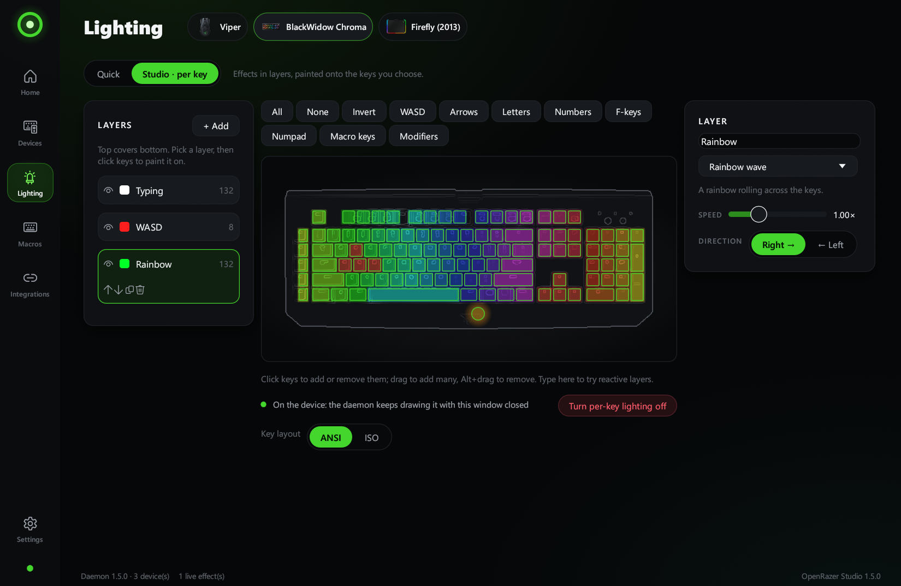
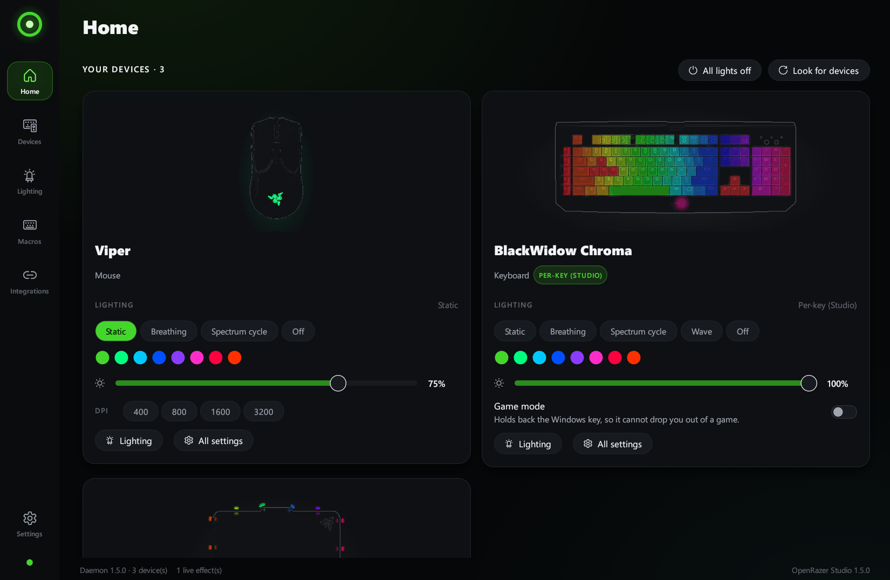
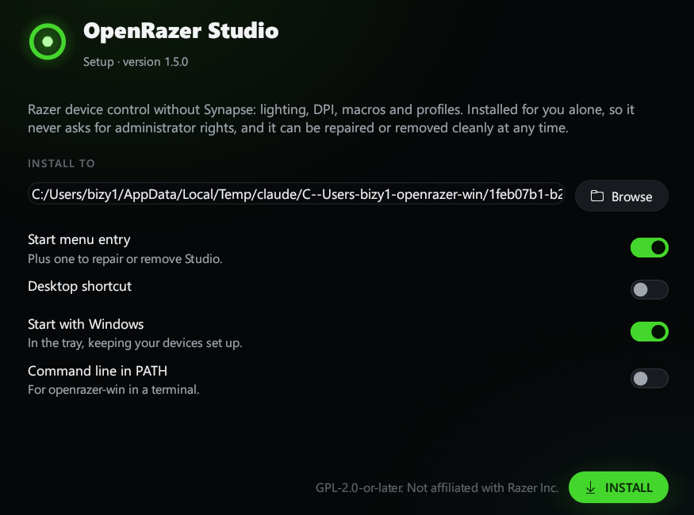
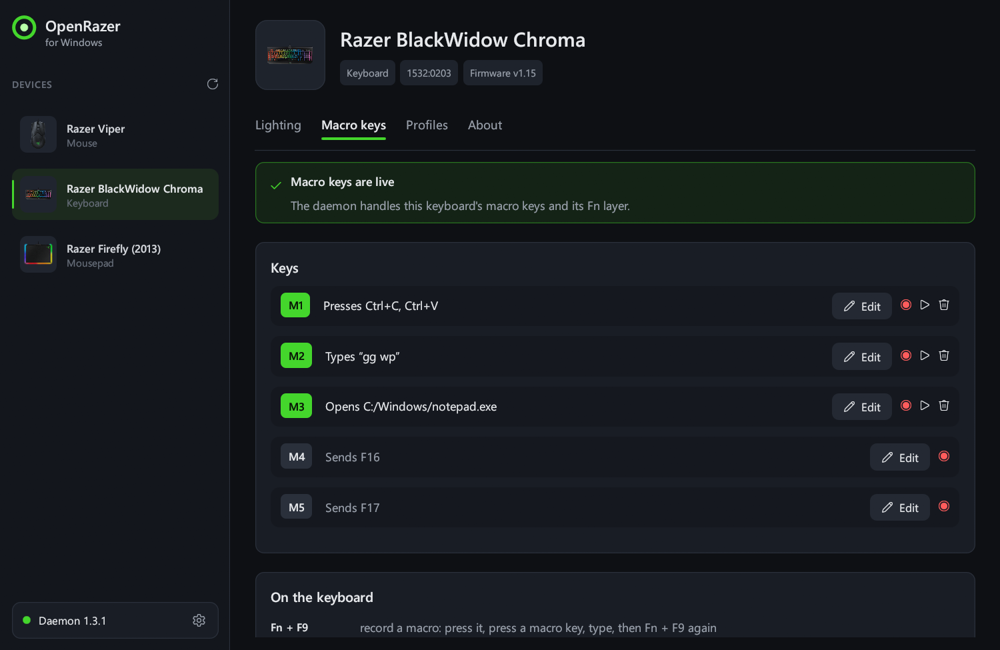

<div align="center">

# OpenRazer for Windows

**Control your Razer keyboard, mouse and mousepad on Windows 10 / 11 — without Synapse, without a kernel driver, without a single third-party package.**

[](https://github.com/Ar4ikov/openrazer-win/actions/workflows/ci.yml)
[](https://www.python.org/downloads/)
[](LICENSE)
[](https://pypi.org/project/openrazer-win/)
[](https://ar4ikov.github.io/openrazer-win/#devices)

[Documentation](https://ar4ikov.github.io/openrazer-win/) ·
[Supported devices](https://ar4ikov.github.io/openrazer-win/#devices) ·
[Upstream OpenRazer](https://github.com/openrazer/openrazer)

</div>

---

[OpenRazer](https://github.com/openrazer/openrazer) is the free Razer driver for Linux: a kernel
module that speaks Razer's vendor USB protocol, plus a D-Bus daemon on top of it. Neither half runs
on Windows.

This is a full port. The protocol layer moves into user space on top of the Windows HID class driver,
D-Bus is replaced by a loopback JSON-RPC daemon, and **every device quirk is transpiled directly from
the upstream C sources** — so all 274 USB devices OpenRazer knows about behave the same way here as they
do on Linux, plus one Bluetooth headset upstream cannot reach at all.

<p align="center"></p>

```console
$ openrazer-win list
Razer BlackWidow Chroma  keyboard   PM1523E01801234     v1.10
Razer Viper              mouse      PM1948H09500666     v1.3

$ openrazer-win effect breath_dual "#ff0080" --colour2 cyan
Razer BlackWidow Chroma: breath_dual on backlight

$ openrazer-win dpi 3200
Razer Viper: dpi (3200, 3200)
```

## Why this exists

| | Synapse | openrazer-win |
|---|---|---|
| Account required | Yes | No |
| Runs in the background | ~200 MB, several services | ~25 MB, one process you start |
| Telemetry | Yes | None — no network access at all |
| Scriptable | No | CLI + Python API + JSON-RPC |
| Works offline / on a locked-down machine | Partially | Fully |
| Source available | No | GPL-2.0-or-later |

## Install

```bash
pip install openrazer-win
```

There is no dependency list to speak of — the port runs on the Python standard library alone. No
compiler, no `hidapi` wheel, no driver signing, no administrator rights, no reboot.

One optional extra exists, for Bluetooth-only devices such as the Kraken Kitty V2 BT:

```bash
pip install "openrazer-win[ble]"
```

That pulls in PyWinRT, because Windows exposes Bluetooth LE through WinRT. Everything on the USB
side keeps working without it.

No Python? Download **`openrazer-studio-setup.exe`** from the
[latest release](https://github.com/Ar4ikov/openrazer-win/releases/latest) and run it: it installs
[OpenRazer Studio](#openrazer-studio) with the daemon, for your account only — no administrator
prompt — and can repair or remove it again at any time. `openrazer-win-gui.exe` in the release is
the classic control panel, a single file with the daemon inside; `openrazer-win.exe` is the command
line, for scripts and terminals. `SHA256SUMS.txt` lists every file's checksum.

> **Close Razer Synapse before using this.** Synapse holds the device open and will fight you for
> control of the LEDs. `openrazer-win doctor` tells you if that is happening.

## Quick start

### Command line

```bash
openrazer-win daemon start          # start the background service
openrazer-win list                  # what is plugged in
openrazer-win info                  # everything about it

openrazer-win effect static red
openrazer-win effect spectrum
openrazer-win effect wave --direction 2
openrazer-win effect breath_dual "#ff0080" --colour2 "#00ffff"
openrazer-win effect ripple green   # host-rendered, follows your typing

openrazer-win zones                  # list a device's zones
openrazer-win zones red blue        # one colour each: left ear red, right ear blue

openrazer-win profile save night    # remember what is showing now
openrazer-win profile               # list saved profiles
openrazer-win profile load night    # put it back

openrazer-win brightness 60
openrazer-win dpi 1800
openrazer-win poll-rate 1000
openrazer-win battery
```

Every command takes `--device` (serial, product id or a fragment of the name), `--zone`
(`backlight`, `logo`, `scroll`, `left`, `right`, …) and `--json`.

To have the daemon come up with Windows:

```bash
openrazer-win autostart enable      # per-user, no admin rights
openrazer-win autostart status
openrazer-win autostart disable
```

This writes one entry under `HKCU\...\CurrentVersion\Run`, so it also appears in Task Manager's
Startup tab and can be removed from there. Only one daemon runs per Windows session: a second
start, from autostart or anywhere else, steps aside for the one already running.

### Macro keys and the Fn layer

Keyboards with macro keys — M1–M5 on a BlackWidow and the like — work while the daemon runs.
An unbound macro key sends F13–F17, which any program that takes hotkeys can use; a bound one
plays its macro instead:

```bash
openrazer-win macro                               # what each key does
openrazer-win macro set M1 --keys "ctrl+shift+esc"
openrazer-win macro set M2 --text "Hello"
openrazer-win macro set M3 --launch "C:\Windows\notepad.exe"
openrazer-win macro record M4                     # type it, then press Enter
openrazer-win macro clear M1                      # back to F13
```

On the keyboard itself, **Fn+F9** records a macro (press it, press a macro key, type, press Fn+F9
again), **Fn+F10** toggles game mode, which holds back the Windows key, and **Fn+F11/F12** step
the backlight.

This works the way upstream's kernel driver does it: the daemon puts the keyboard in *driver
mode*, where it hands its macro keys and its whole Fn layer to the host, and then does the Fn
layer itself — Fn+F1 is still Mute — with the same per-keyboard tables, generated from the
driver's C. A keyboard is only switched over once all of that is in place for it; if the daemon
cannot read its key report, or runs with `--no-keys`, the keyboard stays in normal mode and keeps
its Fn layer to itself. `openrazer-win macro watch` prints the raw key reports, for working out a
keyboard that does not respond.

### Python

The API mirrors upstream's `openrazer.client`, so scripts written for Linux usually port by changing
one import:

```python
from openrazer_win.client import DeviceManager

for device in DeviceManager().devices:
    print(device.name, device.serial, device.firmware_version)

    device.fx.static(0, 255, 0)
    device.brightness = 75

    if device.has('dpi'):
        device.dpi = (1800, 1800)
```

Per-key lighting works the same way as upstream's `fx.advanced`:

```python
keyboard = DeviceManager().by_name('BlackWidow')[0]
matrix = keyboard.fx.advanced
for row in range(matrix.rows):
    for column in range(matrix.columns):
        matrix[row, column] = (255, 0, 128)
matrix.draw()
```

Zones can be painted individually, and a device that can take them all in one message does so, so
the two never disagree even for an instant:

```python
headset = DeviceManager().by_name('Kraken Kitty V2 BT')[0]
headset.colour_zones()                          # ['left', 'right']
headset.set_colour_zones([(255, 0, 0), (0, 0, 255)])
headset.fx_for('left').static(0, 255, 0)        # or one ear at a time
```

Profiles are named snapshots of a device's lighting, kept on the PC — up to ten per device, in
`%LOCALAPPDATA%\openrazer-win\profiles.json`:

```python
device.save_profile('night')
device.profiles                     # [{'name': 'night', 'saved': ..., 'zones': [...]}]
device.load_profile('night')
```

No daemon running? Pass `direct=True` and the library opens the HID handles itself:

```python
DeviceManager(direct=True)
```

### OpenRazer Studio

The app most people want: everything Synapse does for these devices, laid out the way Synapse taught
Razer owners to look for it, in English or Russian.

- **Home** — every device drawn in its own light, as it is lit right now, with what you change most
  beside it: one-click effects and colours, brightness, DPI stages, game mode. *All lights off* puts
  every device in the dark and back.
- **Devices** — DPI with stages, polling rate, battery and sleep, the macro keys, details, and
  **profiles**: save what a device shows, put it back, and link a profile to a game or app so it is
  applied whenever that app is in front.
- **Lighting**, two ways. *Quick*: click a part of the device — the logo, the wheel, the keys — and
  pick an effect, its colours and speed; or apply the same look to every device at once. *Studio*:
  per-key lighting in layers, Chroma Studio style. Each layer is one effect — static, gradient,
  breathing, spectrum, rainbow wave, starlight, reactive, ripple — painted onto the keys you click or
  drag over; upper layers cover lower ones. The daemon draws the result, so it keeps running with
  Studio closed and comes back after a restart; profiles carry it too.
- **Macros** — a library of macros, built step by step (press, hold, let go, wait), recorded in the
  window, or as text to type or a program to open, then put on any macro key of any keyboard.
- **Integrations** — what is planned, to vote on, and the local API that works today.
- **Settings** — language, starting with Windows, the tray, update checks, the daemon, a report to
  attach when asking for help, and **Repair** and **Uninstall**.

Each device is drawn from **its own product photo**: Studio traces the photo into a line drawing,
fits the key layout onto the keycaps in it, and finds the logo and wheel where the photo shows them
lit — so every one of the 275 devices gets a drawing of itself, not a generic shape, and the lights
glow where they really are. Without a photo (offline, say) it draws one.

<p align="center"></p>

**Installing, repairing, removing.** `openrazer-studio-setup.exe` installs to
`%LOCALAPPDATA%\Programs\OpenRazer Studio` and keeps a copy of itself there, which is what
*Settings › Apps › OpenRazer Studio › Modify / Uninstall*, the Start menu's *Repair or remove* entry
and Studio's own settings run. **Repair** compares every file with the one inside the installer and
puts back whatever is missing or damaged — no download — restores the Start menu entry and starting
with Windows, sets aside settings files that no longer read (renamed, not deleted), and clears a
stale note of a daemon that is gone. **Uninstall** closes Studio and the daemon, removes the program,
its shortcuts, its sign-in entry and its Apps & features entry, and asks before touching your
settings. For scripts: `--install --silent [--dir PATH]`, `--repair --silent`,
`--uninstall --silent [--remove-settings | --remove-all-data]`.

<p align="center"></p>

### Classic control panel

`openrazer-win-gui.exe` from the release is the first native Windows app, written in Rust, and is
still shipped as a single file with the daemon inside. Pick a device on the left; on the right:

- **Lighting** — every effect the device has, as tiles with a preview; colours from a picker,
  presets or hex; speed, direction and brightness. Live, host-drawn effects (ripple, smooth wave)
  sit beside the device's own.
- **Performance** — DPI with presets, the DPI stages the mouse button cycles, polling rate.
- **Power** — battery, charging, sleep timer, low-battery warning.
- **Macro keys** — what each key does, editing, recording and trying it out.
- **Profiles** — save what is showing under a name, apply it later.

It starts the daemon itself if it is not running — the one built into it, or one beside it or
installed with pip — and *Settings → Start with Windows* has it come up in the tray at sign-in,
keeping the daemon running; closing the window leaves it in the tray. If no daemon can be found at
all, it offers to download Python from python.org, opens the installer, and installs openrazer-win
into it.
Settings also shows the daemon's state — version, devices still being set up — with start, stop and
restart.

<p align="center"></p>

After `pip install`, `openrazer-win-gui` opens the older, Tk-based panel, which needs nothing
beyond Python.

## How it works

The Linux stack is a kernel module plus a D-Bus daemon. Neither is available on Windows, so each
layer has a direct replacement:

```
                Linux                                   Windows
    ┌────────────────────────────┐        ┌────────────────────────────────┐
    │ openrazer.client (D-Bus)   │        │ openrazer_win.client (JSON-RPC)│
    ├────────────────────────────┤        ├────────────────────────────────┤
    │ openrazer-daemon           │        │ openrazer_win.daemon           │
    │   D-Bus session bus        │        │   loopback TCP + bearer token  │
    ├────────────────────────────┤        ├────────────────────────────────┤
    │ razer*.ko  (kernel module) │        │ openrazer_win.devices          │
    │   sysfs attributes         │        │   recipes transpiled from the  │
    │   usb_control_msg()        │        │   same C sources               │
    ├────────────────────────────┤        ├────────────────────────────────┤
    │ usbhid / usbcore           │        │ hid.dll + setupapi.dll (ctypes)│
    └────────────────────────────┘        └────────────────────────────────┘
```

**The protocol.** Every Razer peripheral speaks the same vendor protocol: a fixed 90-byte structure
delivered as HID feature report `0x00`, with an XOR checksum over bytes 2–87.
`openrazer_win/protocol/` is a line-by-line port of `razercommon.c` and `razerchromacommon.c`.

**Reaching the device.** The kernel driver sends `usb_control_msg` to a specific USB interface.
Windows exposes each interface as its own HID collection, so the port opens the one whose path
carries the matching `&mi_XX` *and* whose report descriptor declares a 90-byte feature report. When
Windows denies read/write access to a keyboard or mouse collection, the port falls back to a
zero-access handle — feature-report IOCTLs are `FILE_ANY_ACCESS`, so they still work.

**The device quirks — the interesting part.** OpenRazer's drivers encode ~20 000 lines of
per-device behaviour as `switch (device->usb_pid)` statements: which report builder to call, which
LED id, which transaction id. Hand-porting that would be a guaranteed source of drift.

Instead, [`tools/transpile_recipes.py`](tools/transpile_recipes.py) parses the C, folds each switch
against every known product id, and emits a small program per (attribute, device):

```json
[{"op": "build", "fn": "razer_chroma_extended_matrix_effect_static",
  "args": [{"k": "const", "value": 1}, {"k": "var", "name": "led_id"},
           {"k": "rgb", "offset": 0}]},
 {"op": "txid", "value": {"k": "const", "value": 63}},
 {"op": "send"}]
```

603 distinct recipes cover all 274 USB devices. `openrazer_win/devices/recipes.py` interprets them at
runtime. Tracking a new upstream release means re-running the transpiler, not rewriting Python.

**The device database** comes from the same place: `tools/extract_device_db.py` imports upstream's
`openrazer_daemon.hardware` package with the Linux-only dependencies stubbed out, and dumps every
device class to JSON — names, matrix dimensions, DPI limits, and the exact method list each device
advertises. Capability reporting intersects that list with the recipe table, so a mouse never claims
to have a backlight it does not have.

## What is supported

| Category | Devices |
|---|---:|
| Mice | 117 |
| Keyboards & laptops | 115 |
| Accessories (docks, stands, ARGB controllers) | 17 |
| Headsets (Kraken protocol) | 8 |
| Headsets (Bluetooth LE) | 1 |
| Mousepads | 8 |
| Keypads | 7 |
| eGPU enclosures | 2 |
| **Total** | **275** |

169 have addressable matrices; 81 report battery level. The full searchable list is
[on the documentation site](https://ar4ikov.github.io/openrazer-win/#devices), or run
`openrazer-win supported`.

**Profiles:** up to ten named lighting snapshots per device, saved on the PC and re-applied on
demand — `openrazer-win profile save night`, `profile load night`.

**Features:** all hardware effects (static, spectrum, wave, wheel, reactive, blinking, breathing ×3,
starlight ×3), per-key custom frames, per-zone brightness, DPI and DPI stages, polling rate up to
8000 Hz, battery level and charging state, idle timeout, low-battery threshold, game mode, macro LED,
scroll mode and acceleration, keyboard layout, addressable-RGB channels, a host-rendered ripple
effect driven by a low-level keyboard hook, and autostart at logon.

### Bluetooth

One device in the range has no USB data mode at all: the **Kraken Kitty V2 BT**. Plugging it in
charges it and nothing more, so upstream has no driver for it — there is no USB device for a kernel
module to bind to.

Its lighting protocol was recovered for this port by capturing what Razer Synapse sends over the
air. It turns out to be a vendor GATT service whose UUID spells `Amel-RazerBLE`, driven by write
commands of the form `c4 00 06` followed by one RGB triple per ear, left first. Setting pure red,
green and blue in Synapse produced exactly those bytes, and a control capture with Synapse closed
produced no writes at all. See
[`openrazer_win/protocol/razer_ble.py`](openrazer_win/protocol/razer_ble.py).

The device itself only knows a static colour per zone. Synapse's breathing, spectrum and
audio-reactive modes are drawn by the host, one frame at a time — which is why closing Synapse stops
the traffic dead — so this port renders them the same way, through its own effect engine:
`effect spectrum` and `effect wave` fall back to the frame-by-frame renderer on any device whose
firmware has no such mode, and say so when they do.

Brightness, battery level and charging state work over Bluetooth too: the vendor service answers
requests on a notify characteristic, since nothing in it can be read directly. Brightness the device
*does* keep across a power cycle — unlike the colour.

**The headset does not store the colour you set.** It shows what it was last told for as long as
the Bluetooth link is up, and reverts to the colour saved in it — whatever Synapse last wrote — the
moment that link goes. So a colour set here is *held*: re-asserted every couple of seconds for as
long as the daemon runs, which is the same thing Synapse does. A command that writes the *stored* colour does exist — this
headset shipped showing white and has shown Razer green ever since Synapse first set it up — but it
appeared in none of the traffic captured here, which points at the one-off setup Synapse performs on
install. It is not implemented and not guessed at: the device answers an unknown opcode with silence
rather than an error, so guessing would be blind, on the channel where firmware pushes live. Profiles
are the practical answer instead.

Three facts about the link, all confirmed on the hardware, decide how it is managed. Resolving the
characteristic costs about 90 ms, most of that service discovery, which no amount of frame streaming
survives — held open, a write costs about 1 ms. A *connected* BLE device stops advertising
altogether, so discovery keeps a device it is connected to even when a sweep hears nothing, and a
link with nothing left to hold is given up after five seconds so the device becomes visible again.
One consequence worth knowing: while the daemon is holding a device, a `--direct` client will not
find it, because there is no advertisement to find.

Devices are found by listening for advertisements rather than by pairing: a dual-mode headset need
not use its classic Bluetooth address on the LE side (this one advertises one byte away from it),
and Windows creates no device node for an unpaired LE connection. Because a sweep takes a few
seconds, the radio is swept far less often than the USB bus, and a missed advertisement is not
treated as an unplugged device.

The Kraken headsets are covered too, through their own protocol: rather than the 90-byte control
report, they expose the lighting controller's RAM, so colours are written to fixed addresses and a
one-byte selector picks the effect. Reading state back from a Kraken is not supported -- the kernel
collects that from unsolicited HID input reports -- so the daemon serves those values from its
persistence file, as upstream's daemon does for devices that cannot report.

**Not ported:** macro recording and playback, which upstream implements on Linux input events.

## Troubleshooting

Start with:

```bash
openrazer-win doctor
```

It lists every Razer HID collection Windows can see, marks the control interface, and says whether
each product id is in the database.

| Symptom | Cause |
|---|---|
| `no Razer control interface` | Synapse is running, or another program holds the device. Close it. |
| Device listed as `NOT IN DATABASE` | Newer than the bundled data. [Open an issue](https://github.com/Ar4ikov/openrazer-win/issues) with the product id. |
| `device replied not supported` | The firmware refused that command; the device genuinely lacks the feature. |
| Effects reset after sleep | Windows cuts USB power. The daemon replays the stored state when the device reappears. |
| Device is connected but nothing is listed | It may be on a charge-only cable, or be a Bluetooth-only model. `doctor` names what Windows sees it as, and says which of the two it is. |
| A Bluetooth device is powered on but not listed | Install the extra: `pip install "openrazer-win[ble]"`. `doctor` ends with a Bluetooth section that says whether support is present and what the radio can hear. |
| Nothing at all listed | Only Razer devices (vendor `1532`) are handled. |
| The control panel says the daemon did not start | It shows what the daemon printed; the same is in `%LOCALAPPDATA%\openrazer-win\daemon-start.log`. |
| Devices do nothing after the daemon starts with Windows | `openrazer-win daemon status` lists devices still waiting to be set up; the daemon keeps retrying them. If it reports an older version, `openrazer-win daemon restart`. |
| Macro keys do nothing | `openrazer-win macro` says whether the keyboard's keys are being handled; `openrazer-win macro watch` shows whether its key report arrives at all. |

## Development

```bash
git clone https://github.com/Ar4ikov/openrazer-win
cd openrazer-win
pip install -e ".[dev]"

pytest                              # 418 tests, no hardware needed
ruff check .
python tools/simulate_devices.py    # every capability of all 274 USB devices
```

OpenRazer Studio and its installer are a Rust workspace in `studio/` — `core` (the daemon's
protocol, the look, English and Russian), `app` and `setup`:

```bash
cd studio
cargo run -p openrazer-studio      # talks to whichever daemon is running
cargo clippy --workspace -- -D warnings && cargo test --workspace
python tools/check_translations.py # every string has its Russian
```

The installer carries what it installs: set `OPENRAZER_STUDIO_PAYLOAD` to a folder holding
`openrazer-studio.exe` and `openrazer-win.exe` before `cargo build -p openrazer-studio-setup`, then
`tools/installer-cycle.ps1` installs, breaks, repairs and removes it, checking every step.
`OPENRAZER_STUDIO_CAPTURE=shot.png OPENRAZER_STUDIO_PAGE=lighting:0:studio` has Studio screenshot a
page and exit.

The classic control panel is the Rust crate in `gui/` (`cargo run` there).
`openrazer-win-daemon --emulate` gives either one emulated devices to show.

The test suite runs against a built-in device emulator that validates CRCs and answers the protocol,
so the whole stack — transport, recipes, daemon, client, CLI — is exercised without plugging anything
in. `--emulate` does the same for the daemon:

```bash
openrazer-win-daemon --emulate
```

### Re-syncing with upstream

```bash
git clone --depth 1 https://github.com/openrazer/openrazer /tmp/openrazer
python tools/extract_device_db.py  /tmp/openrazer openrazer_win/devices/data/devices.json
python tools/transpile_recipes.py  /tmp/openrazer openrazer_win/devices/data/recipes.json
python tools/transpile_keys.py     /tmp/openrazer openrazer_win/devices/data/keys.json
pytest && python tools/simulate_devices.py
```

New devices and changed quirks are picked up automatically.

## Credits

All protocol knowledge here is [OpenRazer](https://github.com/openrazer/openrazer)'s work —
years of reverse engineering by Terri Cain, Tim Theede and a long list of contributors. This project
adds a Windows transport and a translation layer; it does not add a single byte of new protocol
research.

Licensed **GPL-2.0-or-later**, the same as upstream, because the device database and the transpiled
recipes are derived from OpenRazer's GPL sources.

Not affiliated with or endorsed by Razer Inc. Razer, Chroma and Synapse are trademarks of Razer Inc.
