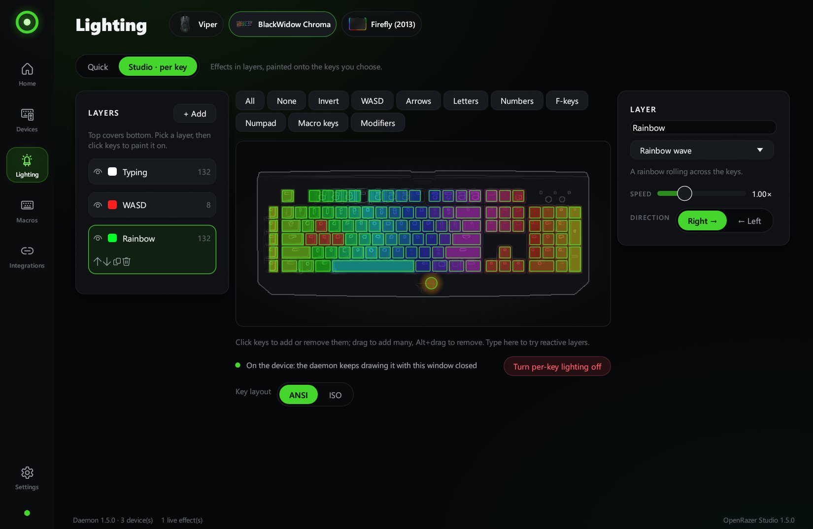
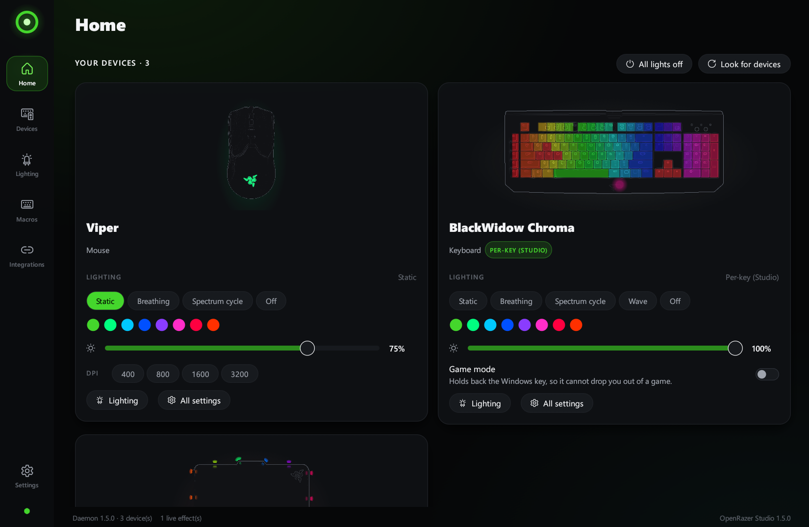
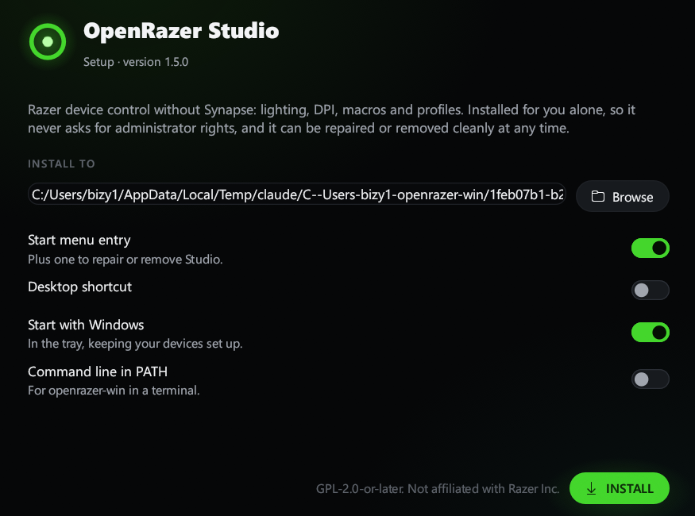
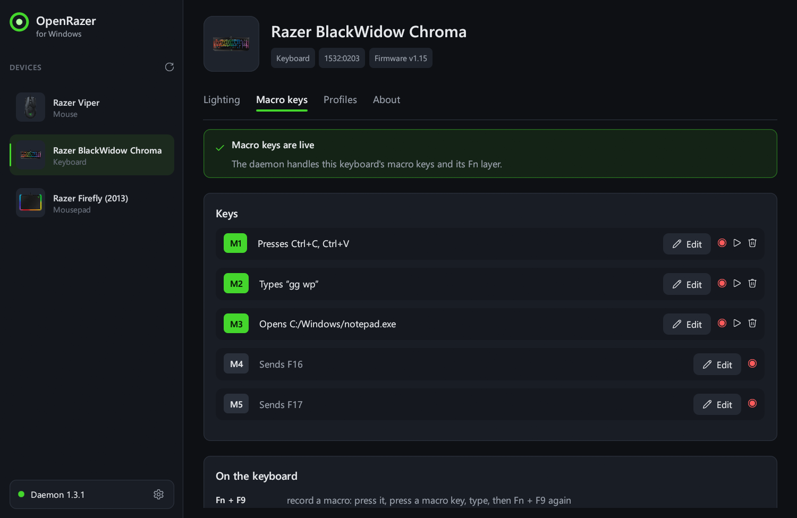

<div align="center">

# OpenRazer for Windows

**Русский** · [English](README.md) · [简体中文](README.zh-CN.md)

**Управляйте клавиатурой, мышью и ковриком Razer в Windows 10 / 11 без Synapse, без драйвера ядра и без единого стороннего пакета.**

[](https://github.com/Ar4ikov/openrazer-win/actions/workflows/ci.yml)
[](https://www.python.org/downloads/)
[](LICENSE)
[](https://pypi.org/project/openrazer-win/)
[](https://ar4ikov.github.io/openrazer-win/#devices)

[Документация](https://ar4ikov.github.io/openrazer-win/) ·
[Поддерживаемые устройства](https://ar4ikov.github.io/openrazer-win/#devices) ·
[OpenRazer (апстрим)](https://github.com/openrazer/openrazer)

</div>

---

[OpenRazer](https://github.com/openrazer/openrazer) — свободный драйвер Razer для Linux: модуль ядра,
который говорит на фирменном USB-протоколе Razer, и D-Bus-демон поверх него. Ни одна из двух частей
в Windows не работает.

Это полный порт. Протокольный уровень переехал в пространство пользователя, поверх HID-драйвера
класса Windows, вместо D-Bus работает демон с JSON-RPC через loopback-порт, а **все особенности
устройств транспилируются прямо из исходников апстрима на C**. Поэтому все 274 USB-устройства,
известные OpenRazer, ведут себя здесь так же, как в Linux. К ним добавлены Pro Type Ultra и розничная
DeathAdder 2000 из pull request в апстрим, которые ещё ждут рассмотрения, Bluetooth-гарнитура, до
которой апстрим добраться не может вообще, BlackShark V2 HyperSpeed, BlackShark V3 X HyperSpeed и
Barracuda X.

<p align="center"></p>

```console
$ openrazer-win list
Razer BlackWidow Chroma  keyboard   PM1523E01801234     v1.10
Razer Viper              mouse      PM1948H09500666     v1.3

$ openrazer-win effect breath_dual "#ff0080" --colour2 cyan
Razer BlackWidow Chroma: breath_dual on backlight

$ openrazer-win dpi 3200
Razer Viper: dpi (3200, 3200)
```

## Зачем это нужно

| | Synapse | openrazer-win |
|---|---|---|
| Нужна учётная запись | Да | Нет |
| Что работает в фоне | ~200 МБ, несколько служб | ~25 МБ, один процесс, который вы запускаете сами |
| Телеметрия | Да | Нет: в сеть не выходит вообще |
| Управление из скриптов | Нет | CLI + Python API + JSON-RPC |
| Работает офлайн и на компьютере с жёсткими ограничениями | Частично | Полностью |
| Открытый исходный код | Нет | GPL-2.0-or-later |

## Установка

```bash
pip install openrazer-win
```

Зависимостей, по сути, нет: порт работает на одной стандартной библиотеке Python. Не нужны ни
компилятор, ни wheel `hidapi`, ни подпись драйвера, ни права администратора, ни перезагрузка.

Есть одна необязательная зависимость (extra), для устройств, которые работают только по Bluetooth,
вроде Kraken Kitty V2 BT:

```bash
pip install "openrazer-win[ble]"
```

Она подтягивает PyWinRT, потому что Bluetooth LE в Windows доступен через WinRT. Без неё всё, что
подключено по USB, работает как обычно.

Нет Python? Скачайте **`openrazer-studio-setup.exe`** со страницы
[последнего выпуска](https://github.com/Ar4ikov/openrazer-win/releases/latest) и запустите: он
поставит [OpenRazer Studio](#openrazer-studio) вместе с демоном только для вашей учётной записи, без
запроса прав администратора, а потом в любой момент сможет её восстановить или удалить.
`openrazer-win-gui.exe` в выпуске — классическая панель управления, один файл с демоном внутри;
`openrazer-win.exe` — командная строка, для скриптов и терминала. В `SHA256SUMS.txt` перечислены
контрольные суммы всех файлов.

> **Перед работой закройте Razer Synapse.** Synapse держит устройство открытым и будет отбирать у вас
> управление светодиодами. Происходит ли это, скажет `openrazer-win doctor`.

## Быстрый старт

### Командная строка

```bash
openrazer-win daemon start          # запустить фоновую службу
openrazer-win list                  # что подключено
openrazer-win info                  # всё об устройстве

openrazer-win effect static red
openrazer-win effect spectrum
openrazer-win effect wave --direction 2
openrazer-win effect breath_dual "#ff0080" --colour2 "#00ffff"
openrazer-win effect ripple green   # рисует компьютер, отвечает на набор текста
openrazer-win effect music cyan     # рисует компьютер, пульсирует под то, что играет

openrazer-win zones                  # зоны устройства
openrazer-win zones red blue        # по цвету на зону: левое ухо красное, правое синее
openrazer-win effect music red --zone left   # эффект на одно ухо, второе остаётся как было

openrazer-win integration accent on # все устройства в цвете акцента Windows и следуют за ним
openrazer-win integration chroma on # игры для Razer Chroma подсвечивают ваши устройства

openrazer-win profile save night    # запомнить то, что сейчас горит
openrazer-win profile               # список сохранённых профилей
openrazer-win profile load night    # вернуть его

openrazer-win brightness 60
openrazer-win dpi 1800
openrazer-win poll-rate 1000
openrazer-win keyswitch gaming      # Huntsman V2: без антидребезга; `typing` возвращает задержку
openrazer-win snaptap on            # из двух противоположных клавиш побеждает нажатая последней; см. ниже
openrazer-win battery
```

Все команды принимают `--device` (серийный номер, product id или часть названия), `--zone`
(`backlight`, `logo`, `scroll`, `left`, `right`, …) и `--json`.

Чтобы демон запускался вместе с Windows:

```bash
openrazer-win autostart enable      # для текущего пользователя, без прав администратора
openrazer-win autostart status
openrazer-win autostart disable
```

Команда добавляет одну запись в `HKCU\...\CurrentVersion\Run`, поэтому её видно и на вкладке
«Автозагрузка» диспетчера задач, и удалить её можно оттуда же. В одном сеансе Windows работает только
один демон: если запустить второй, из автозапуска или откуда угодно ещё, он уступит уже работающему.

### Макроклавиши и слой Fn

Клавиатуры с макроклавишами (M1–M5 на BlackWidow и похожих) работают, пока запущен демон. Свободная
макроклавиша посылает F13–F17, их может использовать любая программа, которая принимает горячие
клавиши; назначенная вместо этого проигрывает свой макрос:

```bash
openrazer-win macro                               # что делает каждая клавиша
openrazer-win macro set M1 --keys "ctrl+shift+esc"
openrazer-win macro set M2 --text "Hello"
openrazer-win macro set M3 --launch "C:\Windows\notepad.exe"
openrazer-win macro record M4                     # наберите макрос, затем нажмите Enter
openrazer-win macro clear M1                      # снова F13
```

На самой клавиатуре **Fn+F9** записывает макрос (нажмите это сочетание, затем макроклавишу, наберите
нужное и снова нажмите Fn+F9), **Fn+F10** включает и выключает игровой режим, в котором клавиша
Windows не срабатывает, а **Fn+F11/F12** меняют яркость подсветки по шагам.

Устроено это так же, как в драйвере ядра апстрима: демон переводит клавиатуру в *режим драйвера*, в
котором она отдаёт компьютеру макроклавиши и весь слой Fn, а затем сам обрабатывает слой Fn (Fn+F1
по-прежнему выключает звук) по тем же таблицам для каждой клавиатуры, сгенерированным из кода драйвера
на C. Демон переключает клавиатуру, только когда для неё всё это готово. Если он не может прочитать её
отчёт о нажатиях или запущен с `--no-keys`, клавиатура остаётся в обычном режиме и обрабатывает слой
Fn сама. `openrazer-win macro watch` печатает сырые отчёты о нажатиях: по ним можно разобраться с
клавиатурой, которая не откликается.

### Боковые кнопки мыши

Двум боковым кнопкам мыши («назад» и «вперёд», в Synapse это *Mouse Button 4* и *5*) можно назначить
клавишу, сочетание клавиш, макрос, другую кнопку мыши или вообще ничего: на вкладке *Кнопки* в Studio
или той же командой:

```bash
openrazer-win macro set MOUSE4 --keys "ctrl+c" -d deathadder   # удерживается, пока нажата кнопка
openrazer-win macro set MOUSE5 --button middle -d deathadder
openrazer-win macro clear MOUSE4 -d deathadder                 # вернуть как было
```

У большинства мышей Razer нет команды, которая задаёт действие кнопки; Synapse тоже переназначает их
на компьютере. Демон делает это через низкоуровневый перехват мыши, который ставится, только пока у
подключённой мыши переназначена боковая кнопка. Windows не сообщает, от какой мыши пришло нажатие,
поэтому, пока эта мышь подключена, её привязки действуют на боковые кнопки всех мышей.

**Basilisk V3** и **Viper Ultimate** хранят назначения кнопок в собственной памяти, поэтому для них
на вкладке *Кнопки* видны ещё и профили, записанные в мышь (у Viper Ultimate он один), действие каждой кнопки на обычном слое и на слое Hypershift
и макросы, которые туда сохранил Synapse. Изменённая здесь кнопка записывается в мышь и работает на
любом компьютере, даже если на нём ничего не запущено; кнопки профиля можно сохранить в файл и
восстановить из него. У Viper Ultimate только так можно отличить правые боковые кнопки от левых.

Такая же память может быть и у других мышей. `openrazer-win buttons` читает, что в ней хранится, и
ничего не записывает: так поддержку мыши можно проверить, прежде чем что-то в ней менять.

### Python

API повторяет `openrazer.client` из апстрима, поэтому скрипт, написанный для Linux, обычно переносится
заменой одного импорта:

```python
from openrazer_win.client import DeviceManager

for device in DeviceManager().devices:
    print(device.name, device.serial, device.firmware_version)

    device.fx.static(0, 255, 0)
    device.brightness = 75

    if device.has('dpi'):
        device.dpi = (1800, 1800)
```

Поклавишная подсветка работает так же, как `fx.advanced` в апстриме:

```python
keyboard = DeviceManager().by_name('BlackWidow')[0]
matrix = keyboard.fx.advanced
for row in range(matrix.rows):
    for column in range(matrix.columns):
        matrix[row, column] = (255, 0, 128)
matrix.draw()
```

Зоны можно раскрашивать по отдельности. Устройство, которое принимает все зоны одним сообщением, так
их и получает, поэтому зоны ни на миг не расходятся:

```python
headset = DeviceManager().by_name('Kraken Kitty V2 BT')[0]
headset.colour_zones()                          # ['left', 'right']
headset.set_colour_zones([(255, 0, 0), (0, 0, 255)])
headset.fx_for('left').static(0, 255, 0)        # или по одному уху
headset.fx_for('right').music(0, 0, 255)        # у уха может быть свой эффект
```

Профили — именованные снимки подсветки устройства. Они хранятся на компьютере, до десяти на
устройство, в `%LOCALAPPDATA%\openrazer-win\profiles.json`:

```python
device.save_profile('night')
device.profiles                     # [{'name': 'night', 'saved': ..., 'zones': [...]}]
device.load_profile('night')
```

Демон не запущен? Передайте `direct=True`, и библиотека сама откроет HID-дескрипторы:

```python
DeviceManager(direct=True)
```

### OpenRazer Studio

Приложение для большинства пользователей: всё, что Synapse делает для этих устройств, разложено так,
как владельцы Razer привыкли искать это в Synapse, на английском, русском или упрощённом китайском.

- **Главная** — плитка на каждое устройство, нарисованное в собственном свете таким, каким оно горит
  сейчас, а рядом то, что меняют чаще всего: эффект, цвет, яркость, ступень DPI, игровой режим.
  *Погасить всё* выключает подсветку на всех устройствах и возвращает её обратно.
- **Каждое устройство** — в списке слева, с вкладками, как в Synapse: *Производительность* (DPI со
  ступенями, частота опроса, оптимизация переключателей), *Подсветка*, *Звук* (у гарнитуры, у которой есть настройки), *Питание* (батарея, сон), *Профили*, *Клавиши* и *Сведения*. Профиль запоминает,
  что показывает устройство, и возвращает это, а профиль, привязанный к игре или программе,
  включается всякий раз, когда она на переднем плане.
- **Подсветка**, двумя способами. *Быстрые эффекты*: нажмите на часть устройства (логотип, колесо,
  клавиши, кошачьи ушки Kraken Kitty) и выберите эффект, его цвета и скорость (у волны тоже, если
  волна устройства принимает скорость, как у Mouse Dock Pro) или примените одно оформление
  сразу ко всем устройствам. *Студия*:
  поклавишная подсветка слоями, как в Chroma Studio. Каждый слой — один эффект (статичный цвет,
  градиент, дыхание, цикл спектра, радужная волна, звёздный свет, реакция на нажатия, рябь), нанесённый на клавиши, по которым вы
  щёлкнули или провели мышью; верхние слои перекрывают нижние. Результат рисует демон, поэтому подсветка
  горит и при закрытой Studio и возвращается после перезапуска; профили её тоже сохраняют.
- **Макросы** — библиотека макросов: собранных по шагам (нажать, удерживать, отпустить, подождать),
  записанных в окне или заданных как текст для набора или программа для запуска; любой из них можно
  назначить на любую макроклавишу любой клавиатуры.
- **Интеграции** — то, что работает уже сейчас, со своими переключателями: **игры с Razer Chroma**,
  **цвет акцента Windows** на всех устройствах, *Музыка* и локальный API; и то, что в планах, за что
  можно проголосовать.
- **Обновления** — что изменилось в каждой версии, на английском, русском или упрощённом китайском; новая версия скачивается и
  ставится по вашей команде. Studio проверяет примерно раз в день и работу не прерывает: о новой версии
  говорит небольшая отметка в меню навигации. Версию можно пропустить, а проверки выключить.
- **Настройки** — язык, запуск вместе с Windows, трей, проверка обновлений, демон, отчёт, который
  прикладывают к просьбе о помощи, и кнопки **Восстановить** и **Удалить**.

Каждое устройство нарисовано **по его собственной фотографии**: Studio обводит фото в контурный
рисунок, подгоняет раскладку клавиш под колпачки на нём и находит логотип и колесо там, где на фото
они светятся. Так у каждого из 283 устройств свой рисунок, без типовых заготовок, и подсветка
горит там, где она есть на самом деле. Без фото (например, когда нет сети) Studio всё равно рисует устройство.

<p align="center"></p>

**Установка, восстановление, удаление.** `openrazer-studio-setup.exe` ставит программу в
`%LOCALAPPDATA%\Programs\OpenRazer Studio` и оставляет там свою копию; её и запускают
*Параметры › Приложения › OpenRazer Studio › Изменить / Удалить*, пункт *Восстановить или удалить OpenRazer Studio* в меню «Пуск»
и настройки самой Studio. **Восстановить** сверяет каждый файл с тем, что лежит внутри установщика, и
возвращает всё пропавшее или повреждённое, ничего не скачивая, восстанавливает пункт в меню «Пуск» и
запуск вместе с Windows, откладывает в сторону файлы настроек, которые больше не читаются (их
переименовывают, не удаляют), и стирает устаревшую запись о демоне, которого уже нет. **Удалить**
закрывает Studio и демон, удаляет программу, её ярлыки, запись автозапуска при входе в систему и запись
в «Приложениях и возможностях», а прежде чем трогать ваши настройки, спрашивает. Для скриптов:
`--install --silent [--dir PATH]`, `--repair --silent`,
`--uninstall --silent [--remove-settings | --remove-all-data]`.

<p align="center"></p>

### Классическая панель управления

`openrazer-win-gui.exe` из выпуска — первое нативное приложение проекта для Windows, написанное на
Rust; оно по-прежнему поставляется одним файлом с демоном внутри. Выберите устройство слева, а справа
будут:

- **Lighting** — все эффекты устройства, плитками с предпросмотром; цвета из палитры, готовых наборов
  или в hex; скорость, направление и яркость. Живые эффекты, которые рисует компьютер (рябь, плавная
  волна), стоят рядом с собственными эффектами устройства.
- **Performance** — DPI с готовыми значениями, ступени DPI, которые перебирает кнопка мыши, частота
  опроса, оптимизация переключателей.
- **Power** — батарея, зарядка, таймер сна, предупреждение о низком заряде.
- **Macro keys** — что делает каждая клавиша, правка, запись и проверка. Боковые кнопки мыши
  настраиваются в Studio или командой `openrazer-win macro`, не здесь.
- **Profiles** — сохранить то, что сейчас горит, под именем и применить позже.

Если демон не запущен, панель запускает его сама: встроенный, лежащий рядом или установленный через
pip. С *Settings → Start with Windows* она появляется в трее при входе в систему и держит демон
запущенным; если закрыть окно, панель остаётся в трее. Если демона не найти вовсе, панель предлагает
скачать Python с python.org, открывает установщик и ставит в этот Python openrazer-win.
В Settings видно и состояние демона (версия, устройства, которые ещё настраиваются), там же кнопки
запуска, остановки и перезапуска.

<p align="center"></p>

После `pip install` команда `openrazer-win-gui` открывает старую панель на Tk, которой кроме Python
ничего не нужно.

### Игры с Razer Chroma

Игра с поддержкой Razer Chroma обращается к Chroma SDK от Razer, который ставит Synapse; без Synapse
она его не находит и ничего не подсвечивает. Когда включены **Игры с Razer Chroma** (раздел
*Интеграции* в Studio или `openrazer-win integration chroma on`), место SDK занимает демон:

- Он отвечает на **REST API** SDK по адресу `localhost:54235`, там же, где отвечает SDK от Razer,
  поэтому программа, написанная под REST API (некоторые игры и веб-страницы, которые подсвечивают
  клавиатуру), работает без изменений.
- Большинство игр вместо этого загружают **DLL** SDK: `RzChromaSDK64.dll` или, в 32-битных,
  `RzChromaSDK.dll`. В Studio есть её замена, собранная из [`studio/chroma`](studio/chroma); когда
  игру добавляют в раздел *Игры*, Studio кладёт подходящую версию рядом с исполняемым файлом игры, а DLL
  рядом с собой игра находит раньше, чем где-либо ещё. Замена передаёт демону то, что показывает игра,
  никогда не заставляет игру ждать и убирается, когда игру удаляют из списка или когда удаляют Studio.
  Собственную DLL от Razer, если игра поставляется с ней, Studio никогда не трогает.

Игра рисует на типах устройств: клавиатура на сетке Razer 6 × 22, мышь на 9 × 7, гарнитура, коврик,
кейпад и Chroma Link. Демон переносит каждый тип на подключённые устройства этого типа: на клавиатуре
по клавишам, на ленте по светодиодам, логотип и колесо мыши берёт из тех мест сетки Razer, где они
стоят, первые два светодиода гарнитуры выводит на её уши. Устройства принадлежат той игре, которая
показала что-то последней. Когда она закрывается или молчит пятнадцать секунд (как и в SDK от Razer),
каждое устройство получает обратно ровно то, что было на нём раньше, включая эффекты, которые рисует
компьютер. Ничего из показанного игрой не сохраняется как ваша подсветка.

Честно о двух ограничениях. Игры с **античитом** (сетевые шутеры и подобные) могут принять незнакомую
DLL за чит, поэтому не добавляйте их. А игры на новом SDK от Razer проверяют, что DLL подписана
Razer, и у этой DLL такой подписи быть не может: здесь такие игры ничего не подсвечивают. Старые игры и всё,
что использует REST API, работают. Если запущен Synapse, порт занят им, и Studio об этом скажет.

### Цвет акцента Windows

Когда включён **Цвет акцента Windows**, все устройства берут цвет, выбранный в Windows, и подхватывают
новый, как только его поменяют в разделе *Параметры › Персонализация › Цвета*; устройство, подключённое позже,
тоже его получает. Следовать за ним может и одно устройство или одно ухо: *Цвет акцента* — это эффект
на вкладке *Подсветка*, а в командной строке — `openrazer-win effect accent`.

## Как это устроено

В Linux это модуль ядра и демон D-Bus. В Windows нет ни того, ни другого, поэтому у каждого уровня есть
прямая замена:

```
                Linux                                   Windows
    ┌────────────────────────────┐        ┌────────────────────────────────┐
    │ openrazer.client (D-Bus)   │        │ openrazer_win.client (JSON-RPC)│
    ├────────────────────────────┤        ├────────────────────────────────┤
    │ openrazer-daemon           │        │ openrazer_win.daemon           │
    │   D-Bus session bus        │        │   loopback TCP + bearer token  │
    ├────────────────────────────┤        ├────────────────────────────────┤
    │ razer*.ko  (kernel module) │        │ openrazer_win.devices          │
    │   sysfs attributes         │        │   recipes transpiled from the  │
    │   usb_control_msg()        │        │   same C sources               │
    ├────────────────────────────┤        ├────────────────────────────────┤
    │ usbhid / usbcore           │        │ hid.dll + setupapi.dll (ctypes)│
    └────────────────────────────┘        └────────────────────────────────┘
```

**Протокол.** Вся периферия Razer говорит на одном фирменном протоколе: структура фиксированной длины
в 90 байт, которая передаётся как HID feature report `0x00`, с контрольной суммой XOR по байтам 2–87.
`openrazer_win/protocol/` — построчный перенос `razercommon.c` и `razerchromacommon.c`.

**Как достучаться до устройства.** Драйвер ядра отправляет `usb_control_msg` на конкретный
USB-интерфейс. Windows показывает каждый интерфейс отдельной HID-коллекцией, поэтому порт открывает ту,
в пути к которой есть нужный `&mi_XX` *и* чей дескриптор отчётов объявляет feature report на 90 байт.
Если Windows не даёт доступ на чтение и запись к коллекции клавиатуры или мыши, порт открывает
дескриптор с нулевыми правами доступа: IOCTL для feature report имеют `FILE_ANY_ACCESS` и работают и так.

**Особенности устройств — самое интересное.** В драйверах OpenRazer около 20 000 строк поведения
отдельных устройств записаны как операторы `switch (device->usb_pid)`: какую функцию сборки отчёта
вызвать, какой id светодиода, какой id транзакции. Перенос этого вручную гарантированно привёл бы к
расхождениям.

Вместо этого [`tools/transpile_recipes.py`](tools/transpile_recipes.py) разбирает код на C, сворачивает
каждый switch для каждого известного product id и выдаёт маленькую программу на каждую пару
(атрибут, устройство):

```json
[{"op": "build", "fn": "razer_chroma_extended_matrix_effect_static",
  "args": [{"k": "const", "value": 1}, {"k": "var", "name": "led_id"},
           {"k": "rgb", "offset": 0}]},
 {"op": "txid", "value": {"k": "const", "value": 63}},
 {"op": "send"}]
```

609 разных рецептов покрывают все 276 USB-устройств. `openrazer_win/devices/recipes.py` исполняет их во
время работы. Чтобы перейти на новый выпуск апстрима, достаточно заново запустить транспилятор,
переписывать код на Python не нужно.

**База устройств** берётся оттуда же: `tools/extract_device_db.py` импортирует пакет апстрима
`openrazer_daemon.hardware`, подменив заглушками зависимости, которые есть только в Linux, и выгружает
каждый класс устройства в JSON: названия, размеры матрицы, пределы DPI и точный список методов, о
которых сообщает каждое устройство. Список возможностей строится как пересечение этого списка с
таблицей рецептов, поэтому мышь никогда не заявит о подсветке, которой у неё нет.

## Что поддерживается

| Категория | Устройств |
|---|---:|
| Мыши | 116 |
| Клавиатуры и ноутбуки | 117 |
| Аксессуары (док-станции, подставки, ARGB-контроллеры) | 17 |
| Гарнитуры (протокол Kraken) | 8 |
| Гарнитуры (Bluetooth LE) | 1 |
| Гарнитуры (BlackShark V2 HyperSpeed) | 2 |
| Гарнитуры (BlackShark V3 X HyperSpeed) | 4 |
| Гарнитуры (Barracuda X) | 1 |
| Коврики | 8 |
| Кейпады | 7 |
| Корпуса для eGPU | 2 |
| **Всего** | **283** |

Upstream поддерживает ещё DeathAdder 3.5G и его версию Black, но здесь их нет. Настройки они
получают USB-запросом, который Windows не даёт отправить ни одной программе, поэтому в Windows они
работают только с теми настройками, что в них уже есть.

У 169 есть адресуемая матрица, 90 сообщают заряд батареи. Полный список с поиском есть
[на сайте документации](https://ar4ikov.github.io/openrazer-win/#devices), или выполните
`openrazer-win supported`.

**Профили:** до десяти именованных снимков подсветки на устройство, они хранятся на компьютере и
применяются заново по запросу: `openrazer-win profile save night`, `profile load night`.

**Возможности:** все аппаратные эффекты (статичный цвет, цикл спектра, волна, круг, реакция на нажатия,
мигание, дыхание ×3, звёздный свет ×3), свои кадры по клавишам, яркость по зонам, DPI и ступени DPI,
частота опроса до 8000 Гц, заряд батареи и состояние зарядки, тайм-аут простоя, порог низкого заряда,
игровой режим, индикатор макросов, оптимизация переключателей («Набор текста» или «Игры», Huntsman V2 и V2 Tenkeyless),
режим и ускорение прокрутки, раскладка клавиатуры, каналы адресуемой RGB-подсветки, эффект ряби,
который рисует компьютер по данным низкоуровневого перехвата клавиатуры, и автозапуск при входе в
систему.

### Snap Tap

Из двух противоположных клавиш побеждает нажатая последней: зажмите A, нажмите D, и A будет отпущена,
пока нажата D, а потом нажата снова, если вы её всё ещё держите. Huntsman V2 Tenkeyless сам так не
умеет, поэтому это делает демон на компьютере, без Synapse и без драйвера. Нажатия физических клавиш
проходят всегда: демон только добавляет свои отпускания и нажатия и придерживает автоповтор
проигравшей клавиши. Пока вы сами не включите Snap Tap, он выключен; включить его можно здесь или на
вкладке *Производительность* в Studio.

```bash
openrazer-win snaptap on                  # в первый раз покажет предупреждение
openrazer-win snaptap pair add w s        # A и D в паре с самого начала
openrazer-win snaptap deny remove cs2.exe # список программ, в которых он не работает
openrazer-win snaptap allow add game.exe  # работать только в перечисленных программах
```

> **Snap Tap программно меняет ваши нажатия клавиш. Некоторые игры это запрещают: Counter-Strike 2
> может выкинуть вас из официальных матчей, а турниры и другие площадки могут наказывать строже. В
> таких играх выключайте его. В играх, запущенных от имени администратора, он не действует, а работать
> может не в каждой игре.**

- Он действует на все клавиатуры, потому что Windows не сообщает, с какой пришло нажатие, и только
  пока работает демон. Клавиши сопоставляются по положению, при любой раскладке.
- Он встаёт на паузу в программах из запретного списка (изначально в нём `cs2.exe`), в любой
  программе не из разрешённого списка, если тот не пуст, и когда нельзя определить, какая программа на
  переднем плане.
- Пока зажат Alt или клавиша Windows, он не вмешивается, чтобы сочетания клавиш работали как обычно.
  Ctrl его не останавливает, так что можно приседать во время стрейфа.

### Bluetooth

У одного устройства в линейке вообще нет режима передачи данных по USB: у **Kraken Kitty V2 BT**. Если
подключить эту гарнитуру кабелем, она только заряжается, поэтому в апстриме драйвера для неё нет:
USB-устройства, к которому мог бы привязаться модуль ядра, просто не появляется.

Протокол её подсветки восстановлен для этого порта по перехвату того, что Razer Synapse передаёт по
радио. Оказалось, это фирменный GATT-сервис, UUID которого складывается в `Amel-RazerBLE`, а управляют
им команды записи вида `c4 00 06`, за которыми идёт по тройке RGB на каждое ухо, сначала левое. Когда в
Synapse выставляли чистый красный, зелёный и синий, уходили ровно эти байты, а в контрольном перехвате
с закрытым Synapse записей не было вовсе. Подробности в
[`openrazer_win/protocol/razer_ble.py`](openrazer_win/protocol/razer_ble.py).

Само устройство умеет только статичный цвет на зону. Дыхание, спектр и режимы, реагирующие на звук, в
Synapse рисует компьютер, кадр за кадром (поэтому, если закрыть Synapse, передача сразу обрывается).
Порт рисует их так же, своим движком эффектов: `effect spectrum` и `effect wave` на любом устройстве,
в прошивке которого такого режима нет, переходят на покадровую отрисовку и сообщают об этом.

У каждого уха может быть свой эффект: плавный спектр, плавная волна, музыка, дыхание, звёздный свет или
цвет акцента Windows на одном, статичный цвет или другой эффект на другом. В Studio для этого выберите левый или правый наушник в поле *Часть*; в командной
строке это `--zone left` или `--zone right`. Демон рисует оба уха в одном кадре, поэтому волна на обоих
по-прежнему перетекает с одного уха на другое, а ухо с простым цветом, пока второе анимировано, входит в
общий кадр, и анимация его не закрашивает.

Яркость, заряд батареи и состояние зарядки по Bluetooth тоже работают: фирменный сервис отвечает на
запросы через notify-характеристику, потому что напрямую в нём ничего прочитать нельзя. Яркость
устройство после выключения *сохраняет*, в отличие от цвета.

**Гарнитура не запоминает цвет, который вы задали.** Пока держится связь по Bluetooth, она показывает
то, что ей сказали последним, а как только связь пропадает, возвращается к цвету, сохранённому в ней
(тому, что последним записал Synapse). Поэтому заданный здесь цвет *удерживается*: демон повторяет его
каждые пару секунд, пока работает, и Synapse делает то же самое. Команда, которая записывает *сохраняемый* цвет, существует: с
завода эта гарнитура светилась белым, а с тех пор, как её впервые настроил Synapse, светится зелёным
Razer. Но ни в одном перехваченном здесь обмене этой команды не было, что указывает на разовую
настройку, которую Synapse делает при установке. Она не реализована, и угадывать её никто не пытался:
неизвестный код операции устройство встречает молчанием, без ошибки, так что подбирать пришлось бы
вслепую, причём по тому каналу, через который заливается прошивка. Практический выход — профили.

Как управлять связью, решают три факта, и все они проверены на железе. Поиск характеристики занимает
около 90 мс, большая часть — на обнаружение сервисов, и потоковая передача кадров такого не выдерживает: при
открытом соединении запись занимает около 1 мс. *Подключённое* BLE-устройство вообще перестаёт рассылать
объявления, поэтому поиск не теряет устройство, к которому подключён, даже если при очередном
сканировании ничего не слышно, а связь, которую больше незачем держать, через пять секунд закрывается,
чтобы устройство снова стало видно. Отсюда следствие: пока демон держит устройство, клиент с `--direct`
его не найдёт, потому что объявлений, по которым его искать, нет.

Устройства находятся по объявлениям, без сопряжения: двухрежимная гарнитура не обязана использовать на
стороне LE свой классический Bluetooth-адрес (эта объявляет адрес, отличающийся от него на один байт),
а для несопряжённого LE-подключения Windows не создаёт узел устройства. Сканирование занимает несколько
секунд, поэтому эфир сканируется гораздо реже, чем шина USB, и пропущенное объявление не считается
отключением устройства.

### BlackShark V2 HyperSpeed

Windows называет её **Razer BlackShark V2 HS 2.4**: `1532:0565` через USB-приёмник, `1532:056E` по
кабелю. Подсветки у неё почти нет. Зато есть настройки, и хранятся они в самой гарнитуре, поэтому
остаются с ней и на телефоне, и на консоли:

```bash
openrazer-win headset                  # батарея, микрофон, самопрослушивание, эквалайзер ...
openrazer-win headset sidetone 8       # слышать свой голос, уровень 0-15
openrazer-win headset eq game          # flat, game, music, movie или custom
openrazer-win headset eq -3,0,0,0,0,0,0,2,3,3   # своя кривая, десять полос в дБ
openrazer-win headset sleep 30         # через сколько минут она выключится сама
```

В Studio то же самое на вкладках *Звук* и *Питание*. В Python всё это читает `device.audio`, а меняют
`device.set_equalizer_preset('game')` и соседние методы.

В апстриме драйвера для неё пока нет. Управляющего отчёта и протокола Kraken она не понимает: у неё
свой протокол MediaTek. Его разобрали авторы
[razer-blackshark-v2-hyperspeed-webhid](https://github.com/justik13/razer-blackshark-v2-hyperspeed-webhid)
и [Synapse-for-Linux](https://github.com/bbesli/Synapse-for-Linux), а на железе он проверен в
[openrazer/openrazer#2974](https://github.com/openrazer/openrazer/pull/2974). Сам порт пока запускали
только на эмуляторе этого протокола, потому что ни у кого в проекте этой гарнитуры нет: если ваша
ведёт себя странно, `openrazer-win doctor` покажет, что Windows о ней видит.

Того, что Synapse добавляет сверху, в гарнитуре нет, поэтому нет и здесь: THX Spatial Audio, шумовой
порог и эквалайзер микрофона работают на компьютере. Кнопка отключения микрофона — собственная кнопка
гарнитуры, Studio только показывает её положение.

### BlackShark V3 X HyperSpeed

`1532:057D` через USB-приёмник, `1532:057C` по кабелю; у версии для PlayStation (`BlackShark V3 X PS`) — `1532:1021` через USB-приёмник и `1532:1022` по кабелю, с тем же протоколом и теми же возможностями. Гарнитура того же рода, что и
предыдущая: настройки она тоже хранит в себе, а протокол у неё опять другой: feature report по 64 байта со
своей раскладкой полей. Настраивается она той же командой, а Studio показывает её на вкладках *Звук*
и *Питание*:

```bash
openrazer-win headset                  # батарея, самопрослушивание, эквалайзер, шумоподавление ...
openrazer-win headset sidetone 8       # уровень 0-15; "off" — это уровень 0
openrazer-win headset eq game          # default, game, music или movie
openrazer-win headset eq -3,0,0,0,0,0,0,2,3,3   # кривая выбранного пресета, от -6 до 6 дБ
openrazer-win headset nc on            # шумоподавление микрофона
openrazer-win headset saving on        # энергосбережение радиомодуля
openrazer-win headset sleep 30         # через сколько минут она выключится сама
```

От V2 HyperSpeed она отличается набором возможностей. Эквалайзер у неё всегда включён, и пресета
custom нет: у каждого из четырёх пресетов своя кривая, и полосы меняют кривую выбранного пресета прямо в
гарнитуре. Она не сообщает, выключен ли микрофон, у неё нет режима «Не беспокоить» и нет подсветки на
приёмнике, которую можно было бы настроить.

Пока гарнитура выключена, ничего не настраивается: приёмник принял бы настройку, сообщил бы об успехе
и потерял бы её, поэтому демон вместо этого говорит, что гарнитура выключена.

В апстриме драйвера для неё тоже пока нет. Поддержка повторяет драйвер, предложенный в
[openrazer/openrazer#2899](https://github.com/openrazer/openrazer/pull/2899), автор которого проверил
его на обоих product id. В этом порту её запускали только на эмуляторе этого протокола, потому что ни
у кого в проекте этой гарнитуры нет: если ваша ведёт себя странно, `openrazer-win doctor` покажет, что
Windows о ней видит.

Остаться включённой навсегда она не может: самое короткое значение таймера сна — пять минут, самое
длинное — 1092.

### Barracuda X (2022)

`1532:0552`, это её USB-C-приёмник. Она хранит те же настройки в тех же регистрах, что и BlackShark
V2 HyperSpeed, но спрашивать их у неё приходится по-своему: приёмник передаёт сообщения гарнитуре
через туннель, и только пока ему это велено. Настраивается она той же командой, а Studio показывает её
на вкладках *Звук* и *Питание*:

```bash
openrazer-win headset                  # батарея, эквалайзер, не беспокоить ...
openrazer-win headset eq game          # flat, game, music, movie или custom
openrazer-win headset eq -3,0,0,0,0,0,0,2,3,3   # кривая custom, десять полос от -5 до 5
openrazer-win headset dnd on           # не беспокоить
openrazer-win headset sleep 30         # 0 (никогда), 5, 15, 30, 45 или 60 минут
```

Значения полос — собственные шаги гарнитуры, не децибелы. Самопрослушивание, игровой режим Bluetooth и
переключение между сопряжёнными устройствами не затрагиваются, как и само сопряжение.

В апстриме драйвера для неё нет. Поддержка повторяет [leag/razer-barracuda](https://github.com/leag/razer-barracuda)
(MIT), где протокол разобрали на самой гарнитуре. В этом порту её запускали только на эмуляторе:
такой гарнитуры ни у кого в проекте нет.

Гарнитуры Kraken тоже поддерживаются, через их собственный протокол: вместо 90-байтного управляющего
отчёта они открывают доступ к оперативной памяти контроллера подсветки, так что цвета пишутся по
фиксированным адресам, а эффект выбирается однобайтовым селектором. Чтение состояния из Kraken не
поддерживается (ядро собирает его из HID-отчётов ввода, которые устройство присылает само), поэтому демон отдаёт эти
значения из своего файла состояния, как демон апстрима делает для устройств, которые не умеют сообщать
о себе.

**Не перенесены:** запись и воспроизведение макросов, которые в апстриме построены на событиях ввода
Linux.

## Решение проблем

Начните с этого:

```bash
openrazer-win doctor
```

Команда перечисляет все HID-коллекции Razer, которые видит Windows, отмечает управляющий интерфейс и
говорит, есть ли каждый product id в базе.

| Признак | Причина |
|---|---|
| `no Razer control interface` | Запущен Synapse или устройство занято другой программой. Закройте её. |
| Устройство помечено `NOT IN DATABASE` | Оно новее встроенных данных. [Создайте issue](https://github.com/Ar4ikov/openrazer-win/issues) и укажите product id. |
| `device replied not supported` | Прошивка отказалась выполнять команду: у устройства действительно нет этой функции. |
| Эффекты сбрасываются после сна | Windows отключает питание USB. Когда устройство появляется снова, демон восстанавливает сохранённое состояние. |
| Устройство подключено, но в списке ничего нет | Возможно, кабель только для зарядки или это модель, которая работает только по Bluetooth. `doctor` скажет, каким Windows видит устройство и какой из двух случаев ваш. |
| Bluetooth-устройство включено, но его нет в списке | Поставьте extra: `pip install "openrazer-win[ble]"`. В конце вывода `doctor` есть раздел про Bluetooth: там сказано, есть ли поддержка и что слышит радиомодуль. |
| Кнопка отключения микрофона на BlackShark оставляет микрофон в Windows на нуле | Судя по рассказам на форуме Razer, так делает Synapse 4, а не гарнитура: с закрытым Synapse кнопка просто выключает микрофон. Один раз поднимите уровень в *Параметрах звука* и закройте Synapse. |
| Вообще ничего нет в списке | Поддерживаются только устройства Razer (vendor `1532`). |
| Панель управления пишет, что демон не запустился | Она показывает, что вывел демон; то же самое лежит в `%LOCALAPPDATA%\openrazer-win\daemon-start.log`. |
| Устройства ничего не делают после того, как демон запустился вместе с Windows | `openrazer-win daemon status` покажет устройства, которые ещё ждут настройки; демон продолжает пробовать их настроить. Если он сообщает более старую версию, выполните `openrazer-win daemon restart`. |
| Игра для Razer Chroma ничего не подсвечивает | `openrazer-win integration` скажет, могут ли игры достучаться до демона и какая из них сейчас что-то показывает. Добавьте игру в *Интеграции › Игры* в Studio и перезапустите её. Игру на новом SDK от Razer, который проверяет подпись Razer, подсветить нельзя. |
| Макроклавиши ничего не делают | `openrazer-win macro` скажет, обрабатываются ли клавиши этой клавиатуры; `openrazer-win macro watch` покажет, приходит ли от неё отчёт о нажатиях вообще. |

## Разработка

```bash
git clone https://github.com/Ar4ikov/openrazer-win
cd openrazer-win
pip install -e ".[dev]"

pytest                              # 418 тестов, железо не нужно
ruff check .
python tools/simulate_devices.py    # все возможности всех 276 USB-устройств
```

OpenRazer Studio и её установщик — рабочее пространство Rust в `studio/`: `core` (протокол демона,
оформление, английский, русский и упрощённый китайский), `app` и `setup`:

```bash
cd studio
cargo run -p openrazer-studio      # работает с тем демоном, который запущен
cargo clippy --workspace -- -D warnings && cargo test --workspace
python tools/check_translations.py # у каждой строки есть русский и китайский перевод
```

Установщик несёт в себе то, что устанавливает: перед `cargo build -p openrazer-studio-setup` укажите в
`OPENRAZER_STUDIO_PAYLOAD` папку с `openrazer-studio.exe` и `openrazer-win.exe`. После этого
`tools/installer-cycle.ps1` устанавливает программу, ломает, восстанавливает и удаляет её, проверяя
каждый шаг. С `OPENRAZER_STUDIO_CAPTURE=shot.png OPENRAZER_STUDIO_PAGE=lighting:0:studio` Studio делает
снимок страницы и закрывается.

Классическая панель управления — крейт на Rust в `gui/` (запускается командой `cargo run` в этой папке).
`openrazer-win-daemon --emulate` даёт любому из двух приложений эмулированные устройства для показа.

Тесты работают со встроенным эмулятором устройств, который проверяет CRC и отвечает по протоколу,
поэтому весь стек (транспорт, рецепты, демон, клиент, CLI) проверяется без единого подключённого
устройства. `--emulate` делает то же для демона:

```bash
openrazer-win-daemon --emulate
```

### Обновление из апстрима

```bash
git clone --depth 1 https://github.com/openrazer/openrazer /tmp/openrazer
python tools/extract_device_db.py  /tmp/openrazer openrazer_win/devices/data/devices.json
python tools/transpile_recipes.py  /tmp/openrazer openrazer_win/devices/data/recipes.json
python tools/transpile_keys.py     /tmp/openrazer openrazer_win/devices/data/keys.json
pytest && python tools/simulate_devices.py
```

Новые устройства и изменённые особенности подхватываются сами. Устройство, которое ещё ждёт своего
pull request в апстриме, хранится в `tools/upstream_patches/` в виде изменений этого pull request в
драйвере и демоне; генераторы накладывают их на временную копию исходников. Когда апстрим принимает
pull request, генераторы сообщают об этом, и патч удаляют.

## Благодарности

Всё знание протокола здесь — работа [OpenRazer](https://github.com/openrazer/openrazer): годы обратной
разработки силами Terri Cain, Tim Theede и длинного списка других участников. Этот проект добавляет
транспорт для Windows и слой трансляции и не вносит ни байта новых исследований протокола.

Лицензия — **GPL-2.0-or-later**, как и у апстрима, потому что база устройств и транспилированные
рецепты получены из исходников OpenRazer под GPL.

Проект не связан с Razer Inc. и не одобрен ею. Razer, Chroma и Synapse — товарные знаки Razer Inc.
