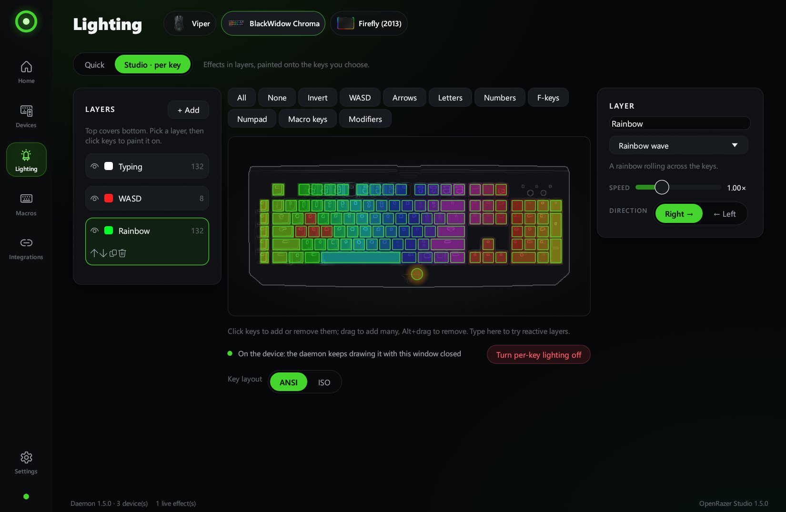
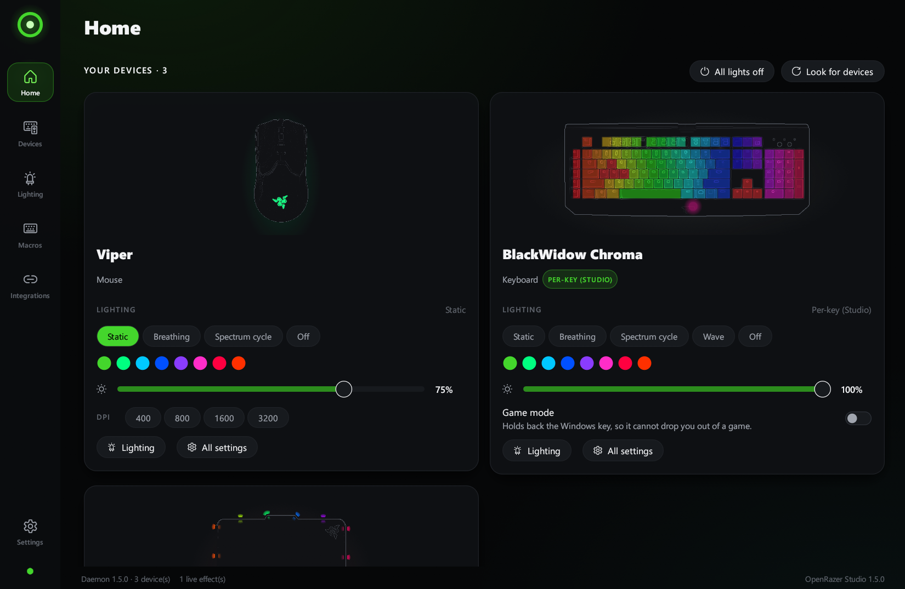
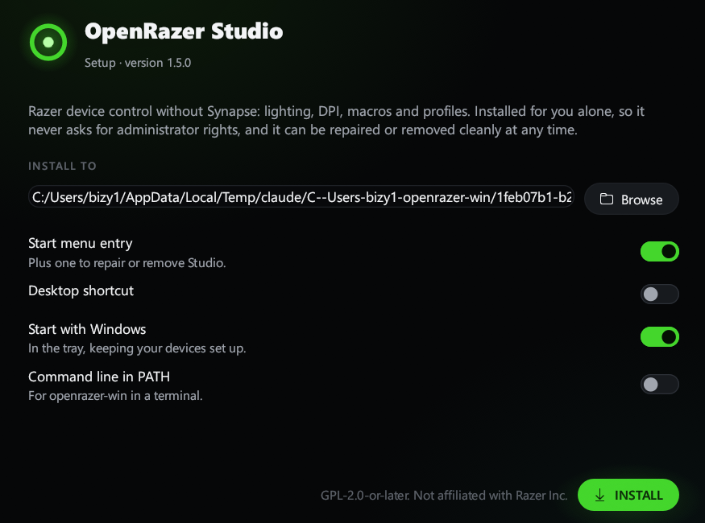
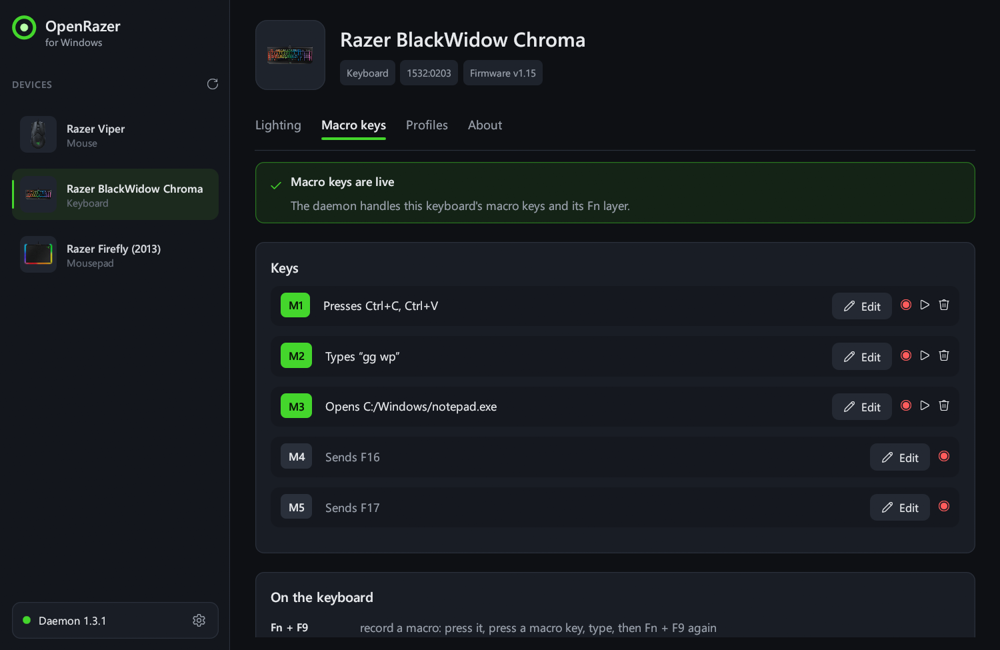

<div align="center">

# OpenRazer for Windows

**简体中文** · [English](README.md) · [Русский](README.ru.md)

**在 Windows 10 / 11 上控制你的 Razer 键盘、鼠标和鼠标垫——无需 Synapse，无需内核驱动，也无需任何第三方软件包。**

[](https://github.com/Ar4ikov/openrazer-win/actions/workflows/ci.yml)
[](https://www.python.org/downloads/)
[](LICENSE)
[](https://pypi.org/project/openrazer-win/)
[](https://ar4ikov.github.io/openrazer-win/#devices)

[文档](https://ar4ikov.github.io/openrazer-win/) ·
[支持的设备](https://ar4ikov.github.io/openrazer-win/#devices) ·
[上游 OpenRazer](https://github.com/openrazer/openrazer)

</div>

---

[OpenRazer](https://github.com/openrazer/openrazer) 是 Linux 上的免费 Razer 驱动：一个内核模块，
负责与 Razer 的厂商 USB 协议通信，外加其上的一个 D-Bus 后台服务。
这两半都无法在 Windows 上运行。

这是一次完整移植。协议层移入用户空间，运行在 Windows HID 类驱动之上，
D-Bus 被替换为回环 JSON-RPC 后台服务，**每一处设备特殊行为都直接从上游 C 源码转译而来**——
因此 OpenRazer 已知的全部 274 个 USB 设备在这里的表现与 Linux 上一致，
此外还有仍在上游拉取请求审查中的 Pro Type Ultra 和零售版 DeathAdder 2000、
上游完全无法触及的一款蓝牙耳机，以及 BlackShark V2 HyperSpeed、BlackShark V3 X HyperSpeed
和 Barracuda X。

<p align="center"></p>

```console
$ openrazer-win list
Razer BlackWidow Chroma  keyboard   PM1523E01801234     v1.10
Razer Viper              mouse      PM1948H09500666     v1.3

$ openrazer-win effect breath_dual "#ff0080" --colour2 cyan
Razer BlackWidow Chroma: breath_dual on backlight

$ openrazer-win dpi 3200
Razer Viper: dpi (3200, 3200)
```

## 为什么做这个

| | Synapse | openrazer-win |
|---|---|---|
| 需要账户 | 是 | 否 |
| 在后台运行 | 约 200 MB，多个服务 | 约 25 MB，一个由你启动的进程 |
| 遥测 | 有 | 无——完全不访问网络 |
| 可脚本化 | 否 | CLI + Python API + JSON-RPC |
| 离线 / 在受限机器上可用 | 部分 | 完全 |
| 源码可用 | 否 | GPL-2.0-or-later |

## 安装

```bash
pip install openrazer-win
```

几乎没有依赖列表可言——这次移植只依赖 Python 标准库。不需要编译器，不需要 `hidapi` 预编译包，
不需要驱动签名，不需要管理员权限，不需要重启。

有一个可选附加项，供 Kraken Kitty V2 BT 这类仅支持蓝牙的设备使用：

```bash
pip install "openrazer-win[ble]"
```

它会引入 PyWinRT，因为 Windows 通过 WinRT 提供 Bluetooth LE。
不装它，USB 这一侧的一切仍照常工作。

没有 Python？从[最新版本](https://github.com/Ar4ikov/openrazer-win/releases/latest)下载
**`openrazer-studio-setup.exe`** 并运行：它只为你的账户安装 [OpenRazer Studio](#openrazer-studio)
和后台服务——不会弹出管理员提示——并且随时可以修复或移除。
发行版里的 `openrazer-win-gui.exe` 是经典控制面板，单文件、内置后台服务；
`openrazer-win.exe` 是命令行，供脚本和终端使用。
`SHA256SUMS.txt` 列出每个文件的校验和。

> **使用前请关闭 Razer Synapse。** Synapse 会一直占用设备，并会和你争夺
> LED 的控制权。`openrazer-win doctor` 会告诉你是否发生了这种情况。

## 快速开始

### 命令行

```bash
openrazer-win daemon start          # 启动后台服务
openrazer-win list                  # 插上了什么
openrazer-win info                  # 关于它的一切

openrazer-win effect static red
openrazer-win effect spectrum
openrazer-win effect wave --direction 2
openrazer-win effect breath_dual "#ff0080" --colour2 "#00ffff"
openrazer-win effect ripple green   # 由主机绘制，跟随你的打字
openrazer-win effect music cyan     # 由主机绘制，随正在播放的内容脉动

openrazer-win zones                  # 列出设备的区域
openrazer-win zones red blue        # 每个区域一种颜色：左耳红，右耳蓝
openrazer-win effect music red --zone left   # 只给一只耳朵设灯效，另一只保持不变

openrazer-win integration accent on # 所有设备使用 Windows 主题色，并跟随它
openrazer-win integration chroma on # 为 Razer Chroma 打造的游戏会点亮你的设备

openrazer-win profile save night    # 记住当前显示的效果
openrazer-win profile               # 列出已保存的配置文件
openrazer-win profile load night    # 把它恢复回来

openrazer-win brightness 60
openrazer-win dpi 1800
openrazer-win poll-rate 1000
openrazer-win keyswitch gaming      # Huntsman V2：不去抖；`typing` 会恢复延迟
openrazer-win snaptap on            # 两个对向按键中，后按下的那个生效；见下文
openrazer-win battery
```

每个命令都接受 `--device`（序列号、产品 ID 或名称片段）、`--zone`
（`backlight`、`logo`、`scroll`、`left`、`right` 等）和 `--json`。

让后台服务随 Windows 一同启动：

```bash
openrazer-win autostart enable      # 按用户，无需管理员权限
openrazer-win autostart status
openrazer-win autostart disable
```

这会在 `HKCU\...\CurrentVersion\Run` 下写入一个条目，因此它也会出现在任务管理器的
启动选项卡中，并可从那里移除。每个 Windows 会话只运行一个后台服务：第二次启动，
无论来自开机自启还是别处，都会让位给已在运行的那个。

### 宏按键与 Fn 层

带宏按键的键盘——比如 BlackWidow 上的 M1–M5 之类——在后台服务运行时可用。
未绑定的宏按键会发送 F13–F17，任何接受热键的程序都能使用；
已绑定的则播放自己的宏：

```bash
openrazer-win macro                               # 每个按键的功能
openrazer-win macro set M1 --keys "ctrl+shift+esc"
openrazer-win macro set M2 --text "Hello"
openrazer-win macro set M3 --launch "C:\Windows\notepad.exe"
openrazer-win macro record M4                     # 输入内容，然后按 Enter
openrazer-win macro clear M1                      # 恢复为 F13
```

在键盘本体上，**Fn+F9** 录制宏（按下它，按一个宏键，输入，再按一次 Fn+F9），
**Fn+F10** 切换游戏模式，该模式会抑制 Windows 键，
**Fn+F11/F12** 调节背光。

做法与上游内核驱动一致：后台服务把键盘切到*驱动模式*，
此时键盘把宏按键和整个 Fn 层交给主机，然后由后台服务自己实现
Fn 层——Fn+F1 仍然是静音——所用逐键盘表同样由驱动的 C 代码
生成。只有当某个键盘的这些内容全部就位后，它才会被切换过去；
如果后台服务读不到它的按键报告，或以 `--no-keys` 运行，
键盘就保持普通模式，Fn 层仍由它自己处理。`openrazer-win macro watch` 会打印
原始按键报告，用于排查没有反应的键盘。

### 鼠标侧键

鼠标的两个侧键——后退和前进，在 Synapse 中称为 *Mouse Button 4* 和 *5*——
可以是一个按键、一个快捷键、一个宏、另一个鼠标按键，或者什么都不指定，
在 Studio 的*鼠标按键*下或使用相同的命令即可：

```bash
openrazer-win macro set MOUSE4 --keys "ctrl+c" -d deathadder   # 按住按键期间持续生效
openrazer-win macro set MOUSE5 --button middle -d deathadder
openrazer-win macro clear MOUSE4 -d deathadder                 # 恢复原状
```

Razer 的大多数鼠标都没有设置按键功能的命令；Synapse 也是在 PC 上重新映射它们。
后台服务用一个低级鼠标钩子完成这件事，只有当已连接的鼠标存在被重新映射的侧键时
才会安装该钩子。Windows 不会说明一次按键来自哪个鼠标，
因此在该鼠标连接期间，它的绑定会作用于所有鼠标的侧键。

**Basilisk V3** 确实把按键保存在自己的内存里，因此在它上面，*鼠标按键*页还会显示
存于鼠标中的配置文件、每个按键在普通层和 Hypershift 层上的功能，
以及 Synapse 保存在那里的宏。在这里改的按键会写入鼠标，在任何电脑上
无需运行任何程序即可生效；配置文件的按键可以备份到文件并恢复。

### Python

API 与上游的 `openrazer.client` 保持一致，
因此为 Linux 编写的脚本通常只需改一处导入就能移植：

```python
from openrazer_win.client import DeviceManager

for device in DeviceManager().devices:
    print(device.name, device.serial, device.firmware_version)

    device.fx.static(0, 255, 0)
    device.brightness = 75

    if device.has('dpi'):
        device.dpi = (1800, 1800)
```

逐键灯效的用法与上游的 `fx.advanced` 相同：

```python
keyboard = DeviceManager().by_name('BlackWidow')[0]
matrix = keyboard.fx.advanced
for row in range(matrix.rows):
    for column in range(matrix.columns):
        matrix[row, column] = (255, 0, 128)
matrix.draw()
```

区域可以单独上色，而能把所有区域放在一条消息里发送的设备会这样做，
因此两者即使在一瞬间也不会不一致：

```python
headset = DeviceManager().by_name('Kraken Kitty V2 BT')[0]
headset.colour_zones()                          # ['left', 'right']
headset.set_colour_zones([(255, 0, 0), (0, 0, 255)])
headset.fx_for('left').static(0, 255, 0)        # 也可以一次只设置一只耳朵
headset.fx_for('right').music(0, 0, 255)        # 一只耳朵可以有自己的灯效
```

配置文件是设备灯效的命名快照，保存在 PC 上——每个设备最多十个，
位于 `%LOCALAPPDATA%\openrazer-win\profiles.json`：

```python
device.save_profile('night')
device.profiles                     # [{'name': 'night', 'saved': ..., 'zones': [...]}]
device.load_profile('night')
```

没有后台服务在运行？传入 `direct=True`，库会自己打开 HID 句柄：

```python
DeviceManager(direct=True)
```

### OpenRazer Studio

大多数人想要的应用：Synapse 为这些设备做的一切，按 Synapse 教会 Razer 用户
寻找它们的方式排布，支持英语、俄语和简体中文。

- **主页**——每个设备一个磁贴，按它此刻点亮的样子用自身灯光绘制，旁边是你最常改的内容：
  灯效、颜色、亮度、DPI 档位、游戏模式。*全部关闭*会把所有设备熄灭，
  再恢复。
- **每个设备**——在左侧列出，标签页与 Synapse 一样：*性能*（带档位的 DPI、
  轮询率、键轴优化）、*灯效*、*声音*（在有相关设置的耳机上）、*电源*（电量、睡眠）、*配置文件*、*按键*和*关于*。配置文件保存
  设备当前显示的效果并可恢复，关联到某个游戏或应用的配置文件会在
  该应用位于前台时自动应用。
- **灯效**，两种方式。*快捷灯效*：点击设备的某个部位——标志、滚轮、
  按键、Kraken Kitty 的猫耳——然后选一种灯效、它的颜色和速度
  （在波浪支持速度的设备上还有波浪速度，例如 Mouse Dock Pro）；
  或者把同样的外观一次性应用到所有设备。*Studio*：以图层方式逐键布光，
  风格类似 Chroma Studio。每个图层是一种灯效——静态、渐变、呼吸、
  光谱、彩虹波浪、星光、反应式、涟漪——画在你点击或拖过的按键上；
  上层覆盖下层。结果由后台服务绘制，因此即使关闭 Studio 也会持续运行，
  重启后仍会恢复；配置文件也会携带它。
- **宏**——一个宏库，可逐步构建（按下、按住、松开、等待），可在窗口中录制，
  或作为要输入的文本、要打开的程序，然后放到任何键盘的任何宏键上。
- **集成**——目前可用的功能及其开关：**支持 Razer Chroma 的游戏**、
  所有设备上的 **Windows 主题色**、*音乐*，以及本地 API；
  还有计划中的功能，可投票。
- **更新**——每个版本的变化，支持英语、俄语和简体中文；新版本在你同意后才下载
  并安装。Studio 大约每天检查一次，从不打断你；有新版本时会在导航栏
  显示一个小标记。可以跳过，也可以关闭检查。
- **设置**——语言、随 Windows 启动、系统托盘、更新检查、后台服务、
  求助时附上的报告，以及**修复**和**卸载**。

每个设备都按**它自己的产品照片**绘制：Studio 把照片描成线稿，
将按键布局贴合到图中的键帽上，并按照片中点亮的位置找出标志和滚轮——
因此 283 个设备中的每一个得到的都是它自己的图，而不是通用形状，
灯光也在真实的位置上发光。没有照片时（比如离线）它会自行画一张。

<p align="center"></p>

**安装、修复、移除。** `openrazer-studio-setup.exe` 安装到
`%LOCALAPPDATA%\Programs\OpenRazer Studio`，并在那里保留一份自身副本，
*设置 › 应用 › OpenRazer Studio › 修改 / 卸载*、开始菜单中的*修复或移除*项
以及 Studio 自己的设置运行的就是这份副本。**修复**会把每个文件与安装程序内的
版本比较，还原缺失或损坏的部分——无需下载——恢复开始菜单项和
随 Windows 启动，把无法再读取的设置文件搁到一旁（重命名，而非删除），
并清除已消失的后台服务留下的过期记录。**卸载**会关闭 Studio 和后台服务，
移除程序、它的快捷方式、它的登录项和它在应用和功能中的条目，
并在改动你的设置之前先询问。供脚本使用：`--install --silent [--dir PATH]`、
`--repair --silent`、`--uninstall --silent [--remove-settings | --remove-all-data]`。

<p align="center"></p>

### 经典控制面板

发行版中的 `openrazer-win-gui.exe` 是第一个原生 Windows 应用，用 Rust 编写，
至今仍以单文件形式发布，并内置后台服务。在左侧选一个设备；右侧是：

- **灯效**——设备具有的每一种灯效，以带预览的磁贴呈现；颜色来自取色器、
  预设或十六进制值；还有速度、方向和亮度。由主机实时绘制的灯效（涟漪、
  平滑波浪）与设备自身的灯效并列。
- **性能**——带预设的 DPI、鼠标按键循环切换的 DPI 档位、轮询率、
  键轴优化。
- **电源**——电量、充电、睡眠定时、低电量警告。
- **宏按键**——每个按键的功能、编辑、录制和试运行。鼠标侧键请在 Studio 中或用
  `openrazer-win macro` 设置，不在这里。
- **配置文件**——以名称保存当前显示的效果，稍后应用。

如果后台服务未运行，它会自行启动——内置的那个，或者旁边的那个，
或者用 pip 安装的那个——*设置 → 随 Windows 启动*会让它登录时
出现在系统托盘中，并保持后台服务运行；关闭窗口只是把它留在托盘里。
如果完全找不到后台服务，它会提议从 python.org 下载 Python，打开安装程序，
并把 openrazer-win 安装进去。
设置还会显示后台服务的状态——版本、仍在配置的设备——
以及启动、停止和重启。

<p align="center"></p>

执行 `pip install` 之后，`openrazer-win-gui` 会打开更早的、基于 Tk 的
面板，除 Python 外不需要任何东西。

### 支持 Razer Chroma 的游戏

为 Razer Chroma 打造的游戏会与 Razer 的 Chroma SDK 通信，该 SDK 由 Synapse 安装；
没有 Synapse，它找不到任何 SDK，也就什么都不点亮。
开启**支持 Razer Chroma 的游戏**后（Studio 的*集成*页，或 `openrazer-win integration chroma on`），后台服务会取代 SDK 的位置：

- 它在 `localhost:54235` 上应答 SDK 的 **REST API**，与 Razer 的 SDK 在同一位置，
  因此针对 REST API 编写的程序——部分游戏，以及会点亮键盘的网页——无需改动即可工作。
- 大多数游戏则加载 SDK 的 **DLL**，`RzChromaSDK64.dll`，32 位时为 `RzChromaSDK.dll`。
  Studio 携带一个由 [`studio/chroma`](studio/chroma) 构建的替代品，
  在游戏于*游戏*下添加时把正确的那个放到游戏程序旁边；
  游戏会先在旁边找 DLL，然后才去别处找。替代品把游戏显示的内容传给后台服务，
  从不让游戏等待，并可从列表中移除，或在卸载 Studio 时移除——
  游戏自带的 Razer 官方 DLL 绝不会被改动。

游戏会按设备类别绘制——键盘使用 Razer 的 6 × 22 网格，鼠标 9 × 7，
还有耳机、鼠标垫、键区和 Chroma Link——后台服务把每一类放到
已插上的同类设备上：键盘上逐键，灯带上逐 LED，鼠标的标志和
滚轮按 Razer 网格中对应的位置，耳机的头两个 LED 落在两只耳朵上。
最后显示内容的游戏占有设备；当它关闭，或像 Razer 的 SDK 那样静默
十五秒后，每个设备都会准确恢复它原先的状态，包括由主机绘制的灯效。
游戏显示的任何内容都不会被保存为你的灯效。

坦白说，有两个限制。带**反作弊**的游戏——在线射击游戏之类——可能把
不认识的 DLL 当成作弊，因此请把它们排除在外。而基于 Razer 更新版 SDK
构建的游戏会检查 DLL 是否由 Razer 签名，这一条无法满足：它们在这里
什么都不点亮。较旧的游戏，以及一切基于 REST API 的内容，都能工作。如果 Synapse 正在运行，它会占用该端口，Studio 会说明这一点。

### Windows 主题色

开启 **Windows 主题色**后，每个设备都会采用 Windows 设定的颜色，并在
*设置 › 个性化 › 颜色*中改动的那一刻再次采用；之后插入的设备也会被告知。
也可以让单个设备或单只耳朵自行跟随它：*主题色*是*灯效*下的一种灯效，
命令为 `openrazer-win effect accent`。

## 工作原理

Linux 上的一整套栈是一个内核模块加一个 D-Bus 后台服务。两者在 Windows 上都
不可用，因此每一层都有直接的替代品：

```
                Linux                                   Windows
    ┌────────────────────────────┐        ┌────────────────────────────────┐
    │ openrazer.client (D-Bus)   │        │ openrazer_win.client (JSON-RPC)│
    ├────────────────────────────┤        ├────────────────────────────────┤
    │ openrazer-daemon           │        │ openrazer_win.daemon           │
    │   D-Bus session bus        │        │   loopback TCP + bearer token  │
    ├────────────────────────────┤        ├────────────────────────────────┤
    │ razer*.ko  (kernel module) │        │ openrazer_win.devices          │
    │   sysfs attributes         │        │   recipes transpiled from the  │
    │   usb_control_msg()        │        │   same C sources               │
    ├────────────────────────────┤        ├────────────────────────────────┤
    │ usbhid / usbcore           │        │ hid.dll + setupapi.dll (ctypes)│
    └────────────────────────────┘        └────────────────────────────────┘
```

**协议。** 每个 Razer 外设都使用同一套厂商协议：一个固定的 90 字节结构，
作为 HID 特性报告 `0x00` 发送，字节 2–87 上有一个 XOR 校验和。
`openrazer_win/protocol/` 是 `razercommon.c` 和 `razerchromacommon.c` 的逐行移植。

**接触设备。** 内核驱动向特定的 USB 接口发送 `usb_control_msg`。
Windows 把每个接口暴露为独立的 HID 集合，因此移植版会打开路径中带有
匹配的 `&mi_XX`、*并且*其报告描述符声明了 90 字节特性报告的那个集合。当 Windows
拒绝对键盘或鼠标集合的读写访问时，移植版会退回到零权限句柄——
特性报告的 IOCTL 是 `FILE_ANY_ACCESS`，因此仍然可用。

**设备特殊行为——有意思的部分。** OpenRazer 的驱动把约 20 000 行的逐设备行为
编码成 `switch (device->usb_pid)` 语句：调用哪个报告构建函数、用哪个 LED id、哪个事务 id。
手工移植必然是偏差的来源。

于是，[`tools/transpile_recipes.py`](tools/transpile_recipes.py) 解析 C 代码，
把每个 switch 对每个已知产品 ID 折叠，并为每个（属性，设备）生成一个小程序：

```json
[{"op": "build", "fn": "razer_chroma_extended_matrix_effect_static",
  "args": [{"k": "const", "value": 1}, {"k": "var", "name": "led_id"},
           {"k": "rgb", "offset": 0}]},
 {"op": "txid", "value": {"k": "const", "value": 63}},
 {"op": "send"}]
```

609 条不同的配方覆盖全部 276 个 USB 设备。`openrazer_win/devices/recipes.py` 在运行时解释它们。
跟进新的上游版本意味着重跑转译器，而不是重写 Python。

**设备数据库**也来自同一处：`tools/extract_device_db.py` 在把仅限 Linux 的依赖
打桩之后导入上游的 `openrazer_daemon.hardware` 包，
并把每个设备类导出为 JSON——名称、矩阵尺寸、DPI 上下限，
以及每个设备声明的方法列表。能力报告会把该列表与配方表取交集，
因此鼠标绝不会声称自己有并不存在的背光。

## 支持的设备

| 类别 | 设备 |
|---|---:|
| 鼠标 | 116 |
| 键盘与笔记本 | 117 |
| 配件（扩展坞、支架、ARGB 控制器） | 17 |
| 耳机（Kraken 协议） | 8 |
| 耳机（Bluetooth LE） | 1 |
| 耳机（BlackShark V2 HyperSpeed） | 2 |
| 耳机（BlackShark V3 X HyperSpeed） | 4 |
| 耳机（Barracuda X） | 1 |
| 鼠标垫 | 8 |
| 键区 | 7 |
| eGPU 外接显卡坞 | 2 |
| **总计** | **283** |

上游还支持 DeathAdder 3.5G 及其 Black 版本，但未计入此表：它们通过一种 Windows 不允许任何程序发送的
USB 请求接收设置，因此在 Windows 上只能保持现有设置。

其中 169 个具有可寻址矩阵；90 个可报告电量。完整的可搜索列表在
[文档站点](https://ar4ikov.github.io/openrazer-win/#devices)，或运行
`openrazer-win supported`。

**配置文件：** 每个设备最多十个命名灯效快照，保存在 PC 上，按需重新应用——
`openrazer-win profile save night`、`profile load night`。

**功能：** 全部硬件灯效（静态、光谱、波浪、滚轮、反应式、闪烁、呼吸 ×3、
星光 ×3）、逐键自定义帧、逐区域亮度、DPI 与 DPI 档位、最高 8000 Hz 的轮询率、
电量与充电状态、空闲超时、低电量阈值、游戏模式、宏 LED、
键轴优化（打字或游戏，Huntsman V2 与 V2 Tenkeyless）、滚轮模式与加速度、
键盘布局、可寻址 RGB 通道、由低级键盘钩子驱动的、由主机绘制的涟漪灯效，
以及登录时自启。

### Snap Tap

两个对向按键中，后按下的那个生效：按住 A，按下 D，A 在 D 按下期间被视为释放，
如果你仍按住 A，之后会重新按下。Huntsman V2 Tenkeyless 自身做不到这一点，
因此由后台服务在 PC 上完成，无需 Synapse 或驱动。物理按键总会传递过去：
它只额外加入自己的释放和按下，并抑制落败按键的自动重复。
它默认关闭，直到你在这里或 Studio 的*性能*下打开它。

```bash
openrazer-win snaptap on                  # 首次使用时显示警告
openrazer-win snaptap pair add w s        # A 和 D 初始就是配对的
openrazer-win snaptap deny remove cs2.exe # 它不生效的程序列表
openrazer-win snaptap allow add game.exe  # 仅在列出的程序中生效
```

> **Snap Tap 会用软件改变你的按键。有些游戏禁止这样做：Counter-Strike 2 可能
> 把你踢出官方比赛，赛事或其他平台可能更进一步。在这些游戏中请关掉它。
> 它对以管理员身份运行的游戏无效，也可能并非在每个游戏中都有效。**

- 它作用于所有键盘，因为 Windows 不会说明按键来自哪一个，且仅在
  后台服务运行时生效。按键按位置匹配，与布局无关。
- 它在以下情况下暂停：程序位于拒绝列表中（该列表以 `cs2.exe` 开头）；
  允许列表非空而程序不在其中；以及前台程序无法被识别时。
- 按住 Alt 或 Windows 键时它会让位，因此快捷键仍是快捷键。Ctrl 不会
  让它停止，所以你可以在横向移动时蹲下。

### 蓝牙

这个系列中有一个设备完全没有 USB 数据模式：**Kraken Kitty V2 BT**。
插上它只会充电，仅此而已，因此上游没有它的驱动——
内核模块没有可绑定的 USB 设备。

它的灯效协议是为这次移植通过抓取 Razer Synapse 空口发送的数据还原出来的。
结果是一个厂商 GATT 服务，其 UUID 拼出 `Amel-RazerBLE`，
由形如 `c4 00 06` 的写命令驱动，后面每只耳朵跟一个 RGB 三元组，左耳在前。
在 Synapse 中设置纯红、绿、蓝时产生的正是那些字节，
而在 Synapse 关闭时做的对照抓包则完全没有写入。
见 [`openrazer_win/protocol/razer_ble.py`](openrazer_win/protocol/razer_ble.py)。

设备本身每个区域只知道一种静态颜色。Synapse 的呼吸、光谱和音频反应模式由主机
逐帧绘制——这也正是关闭 Synapse 后流量立即中断的原因——因此这次移植用
自己的一套灯效引擎以同样方式渲染：`effect spectrum` 和 `effect wave` 会在
任何固件没有相应模式的设备上退回到逐帧渲染器，
并在这样做时说明。

每只耳朵都可以有自己的灯效：一只用平滑光谱、平滑波浪、音乐、呼吸、星光或
Windows 主题色，另一只用静态颜色或其他灯效。在 Studio 中选中一只耳朵
（位于*部位*下）即可做到；在命令行上是 `--zone left` 或 `--zone right`。
后台服务在同一帧中绘制两只耳朵，因此两只耳朵上的波浪仍会从一只传向另一只；
而一只设为纯色、另一只正在动画时，纯色那只也会加入绘制，而不会被覆盖掉。

亮度、电量和充电状态也可通过蓝牙工作：厂商服务在一条通知特征上应答请求，
因为其中没有任何内容可以直接读取。亮度确实会被设备跨断电保留——
颜色则不会。

**耳机不会存储你设置的颜色。** 只要蓝牙链路还在，它就显示最后收到的颜色，
链路一断便回到存储在其中的颜色——也就是 Synapse 最后写入的那个。
因此在这里设置的颜色是*保持*的：只要后台服务在运行，就每隔几秒重新声明一次，
这与 Synapse 的做法相同。确实存在一条写入*已存储*颜色的命令——
这只耳机出厂时显示白色，自从 Synapse 首次配置后便一直显示 Razer 绿——
但它没有出现在这里抓到的任何流量中，这指向 Synapse 在安装时执行的一次性设置。
它既未实现，也未做猜测：设备对未知操作码只用沉默回应，而不是报错，
所以猜也是盲猜，而且是在固件推送实时数据的通道上。
实际可行的答案是用配置文件。

关于这条链路的三个事实都已在硬件上确认，它们决定了它如何被管理。
解析特征大约需要 90 ms，其中大部分花在服务发现上，逐帧流式传输根本撑不起这笔开销——
而保持打开后，一次写入约需 1 ms。处于*已连接*状态的 BLE 设备会完全停止广播，
因此扫描即使什么也听不到，也会保留它已连接的设备；而当一条链路没有
需要维持的内容时，会在五秒后放弃，让设备重新可见。有一个值得知道的后果：
当后台服务正持有某设备时，`--direct` 客户端将找不到它，
因为没有广播可寻。

设备是通过监听广播而不是配对来发现的：双模耳机在 LE 一侧未必
使用它的经典蓝牙地址（这一只的广播地址与它相差一个字节），
而且 Windows 不会为未配对的 LE 连接创建设备节点。由于一次扫描
要几秒钟，无线电扫描的频率远低于 USB 总线，
错过的广播也不会被当作设备拔出。

### BlackShark V2 HyperSpeed

Windows 称它为 **Razer BlackShark V2 HS 2.4**：在 USB 接收器上是 `1532:0565`，
在线上是 `1532:056E`。它几乎没有灯。它有的是保存在耳机自身中的设置，
因此接上手机或游戏机时也会一并保留：

```bash
openrazer-win headset                  # 电量、麦克风、侧音、均衡器……
openrazer-win headset sidetone 8       # 听到自己的声音，级别 0-15
openrazer-win headset eq game          # 平直、游戏、音乐、电影或自定义
openrazer-win headset eq -3,0,0,0,0,0,0,2,3,3   # 自己的曲线，十个频段，单位 dB
openrazer-win headset sleep 30         # 多少分钟后自动关闭
```

Studio 在*声音*和*电源*下显示同样的内容。在 Python 中，`device.audio` 读取
全部信息，`device.set_equalizer_preset('game')` 及其同类方法用于修改。

上游还没有它的驱动。它既不使用控制报告，也不使用 Kraken 的协议，
而是用一套自己的 MediaTek 协议，由
[razer-blackshark-v2-hyperspeed-webhid](https://github.com/justik13/razer-blackshark-v2-hyperspeed-webhid)
和 [Synapse-for-Linux](https://github.com/bbesli/Synapse-for-Linux) 的作者们破解，
并在 [openrazer/openrazer#2974](https://github.com/openrazer/openrazer/pull/2974) 中于硬件上验证。
移植本身目前只在该协议的模拟器上运行过，因为这里没有人拥有这副耳机：
如果你的耳机行为异常，`openrazer-win doctor` 会列出 Windows 所看到的内容。

Synapse 额外提供的东西不在耳机中，因此也不在这里：THX Spatial Audio 以及
麦克风的噪声门和均衡器都在 PC 上运行。静音键是耳机自己的，
Studio 只显示它的状态。

### BlackShark V3 X HyperSpeed

USB 接收器上是 `1532:057D`，线上是 `1532:057C`。与上面那款同类耳机，
设置保存在自身中，但又是另一套协议：64 字节特性报告，布局各不相同。
同样的命令可以设置它，Studio 在*声音*和*电源*下显示：

```bash
openrazer-win headset                  # 电量、侧音、均衡器、降噪……
openrazer-win headset sidetone 8       # 级别 0-15；"off" 为 0
openrazer-win headset eq game          # 默认、游戏、音乐或电影
openrazer-win headset eq -3,0,0,0,0,0,0,2,3,3   # 所选预设的曲线，-6 到 6 dB
openrazer-win headset nc on            # 麦克风降噪
openrazer-win headset saving on        # 无线电省电
openrazer-win headset sleep 30         # 多少分钟后自动关闭
```

它与 V2 HyperSpeed 的差别在于自身具备的功能。它的均衡器始终开启，
且没有自定义预设：四个预设各有一条自己的曲线，设置频段会改变
所选预设的曲线，而这一切都在耳机里。它不会说明麦克风是否静音，
也没有勿扰模式，接收器上也没有可设置的灯。

耳机关机时不会设置任何内容：接收器会接受设置、报告成功，
然后把它丢掉，因此后台服务改为提示耳机已关闭。

上游同样还没有它的驱动。这里遵循
[openrazer/openrazer#2899](https://github.com/openrazer/openrazer/pull/2899) 中提出的方案，
其作者在两个产品 ID 上都做过测试。在这里它只在该协议的模拟器上运行过，
因为这里没有人拥有这副耳机：如果你的耳机行为异常，`openrazer-win doctor` 会列出 Windows 所看到的内容。

它没有办法保持常开：它的睡眠定时最短五分钟，
最长 1092。

### Barracuda X（2022）

`1532:0552`，它的 USB-C 接收器。它把相同的设置保存在与 BlackShark V2 HyperSpeed
相同的寄存器中，但以自己的方式请求：接收器通过一条隧道把消息转发给耳机，
且只在被要求时。同样的命令可以设置它，
Studio 在*声音*和*电源*下显示：

```bash
openrazer-win headset                  # 电量、均衡器、勿扰……
openrazer-win headset eq game          # 平直、游戏、音乐、电影或自定义
openrazer-win headset eq -3,0,0,0,0,0,0,2,3,3   # 自定义曲线，十个频段，-5 到 5
openrazer-win headset dnd on           # 勿扰
openrazer-win headset sleep 30         # 0（永不）、5、15、30、45 或 60 分钟
```

这些频段是耳机自身的档位，而不是分贝。侧音、蓝牙游戏模式以及在已配对
设备之间切换都保持原样，配对也是如此。

上游没有它的驱动。这里遵循 [leag/razer-barracuda](https://github.com/leag/razer-barracuda)（MIT），
其作者在耳机上破解了协议。在这里它只在模拟器上运行过，
因为这里没有人拥有一个。

Kraken 系列耳机也通过自己的协议得到支持：它们不使用 90 字节控制报告，
而是暴露灯光控制器的 RAM，因此颜色被写入固定地址，
由一个单字节的选择器挑选灯效。从 Kraken 读回状态不受支持——
内核是从未经请求的 HID 输入报告收集这些的——因此后台服务从其持久化文件中
提供这些值，正如上游后台服务对无法报告状态的设备所做的那样。

**未移植：** 宏录制与回放，上游在 Linux 上基于输入事件实现。

## 故障排查

从这里开始：

```bash
openrazer-win doctor
```

它会列出 Windows 能看到的所有 Razer HID 集合，标出控制接口，
并说明每个产品 ID 是否在数据库中。

| 症状 | 原因 |
|---|---|
| `no Razer control interface` | Synapse 正在运行，或其他程序占用了设备。关掉它。 |
| 设备显示为 `NOT IN DATABASE` | 比内置数据更新。[提交问题](https://github.com/Ar4ikov/openrazer-win/issues)并附上产品 ID。 |
| `device replied not supported` | 固件拒绝该命令；设备确实没有这个功能。 |
| 睡眠后灯效被重置 | Windows 切断了 USB 供电。设备重新出现时，后台服务会重放已保存的状态。 |
| 设备已连接但列表为空 | 可能用了仅充电的线缆，或是仅支持蓝牙的型号。`doctor` 会说明 Windows 把它识别成什么，并告知属于这两种情况中的哪一种。 |
| 蓝牙设备已开机但未列出 | 安装可选附加项：`pip install "openrazer-win[ble]"`。`doctor` 末尾有蓝牙一节，说明是否具备支持以及无线电能听到什么。 |
| BlackShark 的静音键让 Windows 中麦克风电平归零 | 据 Razer 论坛上的说法，是 Synapse 4 而非耳机的问题：关闭 Synapse 后这个键只是静音。在*声音设置*中把电平调高一次，然后关闭 Synapse。 |
| 完全没有列出任何设备 | 只处理 Razer 设备（厂商 `1532`）。 |
| 控制面板提示后台服务未启动 | 它会显示后台服务打印的内容；同样的内容也在 `%LOCALAPPDATA%\openrazer-win\daemon-start.log` 中。 |
| 后台服务随 Windows 启动后设备没有反应 | `openrazer-win daemon status` 会列出仍在等待配置的设备；后台服务会持续重试。如果它报告的是较旧版本，运行 `openrazer-win daemon restart`。 |
| 为 Razer Chroma 打造的游戏什么都不点亮 | `openrazer-win integration` 会说明游戏能否访问后台服务，以及哪个正在显示内容。在 Studio 的*集成 › 游戏*下添加该游戏并重启它。基于 Razer 更新版 SDK 构建的游戏会检查 Razer 的签名，无法点亮。 |
| 宏按键没有反应 | `openrazer-win macro` 会说明键盘的按键是否正被处理；`openrazer-win macro watch` 显示它的按键报告是否到达。 |

## 开发

```bash
git clone https://github.com/Ar4ikov/openrazer-win
cd openrazer-win
pip install -e ".[dev]"

pytest                              # 418 项测试，无需硬件
ruff check .
python tools/simulate_devices.py    # 全部 276 个 USB 设备的每一项能力
```

OpenRazer Studio 及其安装程序是 `studio/` 下的一个 Rust 工作区——
`core`（后台服务的协议、外观、英语、俄语和简体中文）、`app` 和 `setup`：

```bash
cd studio
cargo run -p openrazer-studio      # 与正在运行的后台服务通信
cargo clippy --workspace -- -D warnings && cargo test --workspace
python tools/check_translations.py # 每个字符串都有对应的俄语和简体中文
```

安装程序携带它所安装的内容：在 `cargo build -p openrazer-studio-setup` 之前，
把 `OPENRAZER_STUDIO_PAYLOAD` 设为一个包含 `openrazer-studio.exe` 和
`openrazer-win.exe` 的文件夹，然后 `tools/installer-cycle.ps1` 会安装、破坏、修复
并移除它，逐步检查每个环节。
`OPENRAZER_STUDIO_CAPTURE=shot.png OPENRAZER_STUDIO_PAGE=lighting:0:studio` 让 Studio 对某个页面截图并退出。

经典控制面板是 `gui/` 中的 Rust crate（在那里运行 `cargo run`）。
`openrazer-win-daemon --emulate` 可以给两者提供模拟设备来显示。

测试套件针对内置的设备模拟器运行，该模拟器校验 CRC 并应答协议，
因此整条栈——传输、配方、后台服务、客户端、CLI——都无需插入任何
设备即可得到检验。`--emulate` 对后台服务做同样的事：

```bash
openrazer-win-daemon --emulate
```

### 与上游重新同步

```bash
git clone --depth 1 https://github.com/openrazer/openrazer /tmp/openrazer
python tools/extract_device_db.py  /tmp/openrazer openrazer_win/devices/data/devices.json
python tools/transpile_recipes.py  /tmp/openrazer openrazer_win/devices/data/recipes.json
python tools/transpile_keys.py     /tmp/openrazer openrazer_win/devices/data/keys.json
pytest && python tools/simulate_devices.py
```

新设备和变化了的特殊行为会被自动纳入。仍在上游拉取请求中等待的设备，
会以该拉取请求对驱动和后台服务的改动形式保存在 `tools/upstream_patches/` 中，
生成器会把它们应用到检出副本的临时拷贝上。一旦上游合并，
生成器会说明这一点，补丁随即删除。

## 致谢

这里的所有协议知识都来自 [OpenRazer](https://github.com/openrazer/openrazer) 的工作——
Terri Cain、Tim Theede 以及一长串贡献者多年的逆向工程。
本项目增加了 Windows 传输层和一层转换；
它没有增加一个字节的新协议研究。

以 **GPL-2.0-or-later** 授权，与上游相同，因为设备数据库和
转译出的配方源自 OpenRazer 的 GPL 源码。

与 Razer Inc. 无关联，也未获其认可。Razer、Chroma 和 Synapse 是 Razer Inc. 的商标。
